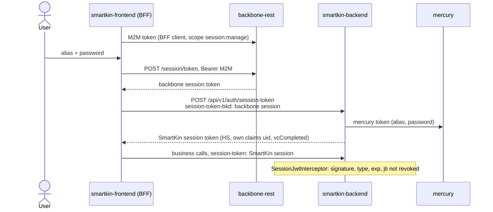

# Sessions and users through backbone-rest

How identity works for SmartKin: who issues which token, which backbone call needs which credential, what smartkin-backend does
today, and what is still open. It was written from the sources, not from memory:

| Source | Used for |
|---|---|
| `backbone-rest/docs/api/session.md`, `managed-clients.md`, `users.md`, `docs/runbooks/zerobound-application-client.md`, `CLAUDE.md` | The contract of backbone (the reference) |
| `zerobound-rest/docs/decisions/D-10-user-self-registration.md`, `src/main/java/.../registration/backbone/*`, `shared/http/ServiceRestClients.java` | A working client of that contract (the reference implementation) |
| `smartkin-backend/src/main/java/...` and `smartkin-frontend/server/controller/*` | What SmartKin does now |

Every statement says where it comes from. Anything marked **Not verified** was not confirmed against a running backbone.

## 1. The model

Backbone owns identity for every product. Three things take part, and none is optional:

| Piece | What it is | In SmartKin |
|---|---|---|
| **Application** | The product (tenant). Users and roles exist inside one. | `umdc.smartkin.application-id` (`SMARTKIN` application UUID) |
| **Application user** | A person linked to the application with a role. A person not linked gets `404` at login whatever the password. | Created by `POST /api/v1/users` with `umdc.smartkin.role-id` |
| **Application client** | A *managed client* (MCAM): `clientId` + `clientSecret` + a list of scopes, bound to **one** application. | `BACKBONE_CLIENT_ID` / `BACKBONE_CLIENT_SECRET` / `BACKBONE_SCOPE` |

Two kinds of token, and they are **not interchangeable**:

| | M2M token | Session token |
|---|---|---|
| Issued by | `POST /api/v1/managed-clients/token` | `POST /api/v1/session/token` (email) or `POST /api/v1/session` (alias) |
| Signed | RS256, ~1 h | HS512 with `APP_TOKEN_SECRET`, ~1 h (refresh token ~7 days) |
| Claims | `iss=backbone-rest`, `type=M2M`, `scopes` | `type=session-token`, `uid`, `jti`, `aid` (application id) |
| Carried in | `Authorization: Bearer` | `session-token` header |
| Who it identifies | A service (a client) | A person |

A token that Stratum validates can still be refused by SmartKin: an M2M token is genuine but is not a session token
(wrong algorithm, wrong `type`, no `uid`). This is by design.

## 2. The backbone contract SmartKin depends on

All paths are under backbone's base URL (`BACKBONE_BASE_URL`, `https://api.umdc-qa.tst/backbone` in QA).

### M2M token

`POST /api/v1/managed-clients/token`, public, JSON:

```json
{ "clientId": "<uuid>", "clientSecret": "***", "scopes": ["users:manage"] }
```

`200 {"accessToken": "<rs256-jwt>", "tokenType": "Bearer", "expiresIn": 3600, "scopes": [...]}`.
`400 invalid_scope` when the scopes are not a subset of those registered for the client; `401 invalid_client` for an unknown or
inactive client or a wrong secret; `429` over the rate limit.

### Session (user login), used by the BFF

| Call | Headers | Notes |
|---|---|---|
| `POST /api/v1/session/token` `{email, password, applicationId}` | `Authorization: Bearer <M2M>` | `{sessionToken\|token, refreshToken}`; both carry `aid`. `403` if the client belongs to another application; `401` if the application requires a client and none is sent |
| `POST /api/v1/session` `{alias, password, applicationId}` | same | login by alias |
| `GET /api/v1/session/validate` | `session-token` | raw `true`/`false` (not an object); `false` for a wrong `type` or a revoked `jti` |
| `GET /api/v1/session/renew` | `session-token` | new session token; the old one is **not** revoked |
| `POST /api/v1/session/refresh` `{refreshToken}` | | new pair, keeps `aid` |
| `POST /api/v1/session/logout` `{refreshToken?}` | `session-token` | `204`; both `jti` go to the Redis deny-list (`jti:<value>`) until they would expire |

### Users, used by smartkin-backend

All of these accept an M2M token **with scope `users:manage` and only for the application of the client** (`UserAdminGuard`);
without the scope or for another application the answer is `403` (`404` for a read of a user of another application).

| Call | Used by |
|---|---|
| `GET /api/v1/users/check/email/{email}/application/{id}` and `.../check/alias/{alias}/...` | `UserServiceImpl.create` (`200` free, `409` taken) |
| `POST /api/v1/users` | `UserServiceImpl.create` |
| `PUT /api/v1/users/application/{id}/user/{userId}/activate` | `UserRegisterServiceImpl.confirmCode`, once mercury accepts the code (finding F-4, fixed) |
| `GET /api/v1/users/user/{userId}` | `findUser`, `confirmCode` |
| `DELETE /api/v1/users/application/{id}/user/{userId}` | `deleteUserByUserAndApplication` |

Backbone's password policy (`umdc.password-policy`: 8 to 128 characters, upper, lower, digit and special) is the authority; its `400` is
passed through.

## 3. What SmartKin does today



1. **BFF login.** The BFF gets an OAuth bearer (`BACKBONE_AUTH_*` in its configuration), logs the user in to backbone with the
   application id and an AES-encrypted password, and keeps the backbone session (`user-session-store`).
2. **SmartKin session.** The BFF then calls `POST /api/v1/auth/session-token` with the backbone session in `session-token-bkd`.
   `AuthServiceImpl.token(authRequest, sessionTokenBkd)` asks mercury for a token with the alias and password, reads `uid` from the
   backbone session, asks mercury whether the verification code is done and signs **SmartKin's own session JWT** (`SessionJwtServiceImpl`,
   claims `jti`, `type=session-token`, `uid`, `vcCompleted`).
3. **Every other call** carries that token in `session-token`. The library's `SessionJwtInterceptor` (`security-oauth`) reads only that header
   and calls `SessionJwtServiceImpl.isValid`: signature with `APP_TOKEN_SECRET` (Base64), `type=session-token`, not expired, non-blank
   `jti` and not on backbone's Redis deny-list (`RedisRevocationChecker`, fails closed with `503`). Without the header the answer is
   `401` with `Message-ID: Token invalid.` An endpoint opts out with `@SkipSessionValidation` (sign-up only).
4. **Sign-up.** `POST /api/v1/users` (open) calls backbone `check/email`, creates the user (`applicationId`, `roleId` from configuration,
   generated alias) and publishes the verification e-mail to Kafka.
5. **Confirm code.** `POST /api/v1/user-register` finds the user in backbone, logs in to mercury and posts the code.
6. **Outbound calls** use Feign with an interceptor per client (`BackboneFeignConfigurer`, `MercuryFeignConfigurer`) that adds an M2M bearer.

### Changed with this document

* `BackboneFeignConfigurer` now gets its bearer the way zerobound-rest does: `POST {BACKBONE_BASE_URL}/api/v1/managed-clients/token` with
  the `backbone` client's id, secret and scope (`BACKBONE_REGISTRATION_CLIENT_ID`, `BACKBONE_REGISTRATION_CLIENT_SECRET`, `BACKBONE_M2M_SCOPES`). It keeps the token until a
  minute before its `exp`. Before, it posted a Keycloak-style form to `AUTH_SERVER_URI` + `AUTH_TOKEN_URI`
  (`/auth/realms/umdc/token`), which backbone no longer serves (it answers `404`).
* The token request goes through `RestTemplateBuilder.sslBundle(smartkin-security)`. A bare `new RestTemplate()` uses the JVM trust store, which
  does not hold the internal CA (`umdc-local-ca`), hence `PKIX path building failed` against `api.umdc-qa.tst`. zerobound-rest does the same
  with `BACKBONE_SSL_BUNDLE`.

`MercuryFeignConfigurer` still uses the old form post. **Not verified**: mercury's contract is `POST /api/v1/auth/token {alias, password}`
(zerobound-rest `docs/OPERATIONS.md`, "Mercury"), a static registry of calling services, and it is not known whether `MERCURY_USERNAME` /
`MERCURY_PASSWORD` in Vault are such a pair. It is left alone until that is confirmed.

## 4. What has to exist in backbone (checklist)

Done once per environment by an administrator (Stratum: *Applications > smartkin > Managed clients*), following
`backbone-rest/docs/runbooks/zerobound-application-client.md`:

1. Application `smartkin` exists; its id is `umdc.smartkin.application-id`. The customer/parent role id is `umdc.smartkin.role-id`.
2. **BFF client** (`smartkin-frontend`): scope `session:manage`, bound to the application. Its id/secret go to the BFF's secrets.
3. **smartkin-backend client** (its own, never the BFF's): scope **`users:manage`**, bound to the application. Its id/secret are the Vault keys
   `BACKBONE_REGISTRATION_CLIENT_ID` / `BACKBONE_REGISTRATION_CLIENT_SECRET` of smartkin-backend (its own managed client, as in zerobound-rest; `BACKBONE_CLIENT_*` stay with the security-oauth library) and the scopes asked for the M2M token (`BACKBONE_M2M_SCOPES`, default `users:manage`) must be registered for the client (or any subset of the
   registered scopes; `invalid_scope` otherwise). The secret is shown once.
4. Optional hardening: add the application id to `SESSION_CLIENT_REQUIRED_APPLICATIONS` so a login without the BFF's client answers `401`.

Check from a shell (same as the runbook, step 5/6):

```bash
HOST=https://api.umdc-qa.tst/backbone
M2M=$(curl -s -X POST "$HOST/api/v1/managed-clients/token" -H 'Content-Type: application/json' \
  -d "{\"clientId\":\"$CLIENT_ID\",\"clientSecret\":\"$CLIENT_SECRET\",\"scopes\":[\"users:manage\"]}" | jq -r .accessToken)
curl -s -o /dev/null -w '%{http_code}\n' "$HOST/api/v1/users/check/email/someone@example.com/application/$APP_ID" -H "Authorization: Bearer $M2M"   # 200 or 409
```

## 5. Findings: what differs from the reference and should be decided

Numbered so they can become tasks. None of them was changed here except where stated.

| # | Finding | Evidence | Risk |
|---|---|---|---|
| F-1 | Backbone and mercury tokens were requested from a Keycloak path that no longer exists. Backbone: **fixed** (section 3). Mercury: open. | `404` from `/auth/realms/umdc/token`; `MercuryFeignConfigurer` | Every Feign call failed with a `500` on sign-up |
| F-2 | Outbound token calls ignored the internal CA. **Fixed** for the token request. The Feign clients themselves use Spring Cloud OpenFeign's default client. | `PKIX path building failed` | Calls to `*.umdc-qa.tst` over TLS fail unless the JVM trusts the CA. **Not verified** for the Feign calls after the token |
| F-3 | `UserServiceImpl.create` turns **any** `FeignException` into `409 Email already exists`. A `401`/`403` from backbone (bad client, missing scope) or a `5xx` looks like a duplicate e-mail. | `UserServiceImpl.create` | Misleading errors; this is why the real cause stayed hidden. Map `409` only, relay the rest (the project convention is `e.status()` plus `MESSAGE_HEADER`) |
| F-4 | Nothing activates the user after the verification code. D-10 creates the user `active=false` and calls `PUT .../activate` once mercury confirms the code. `UserCreateMapper` ignores `active` and `confirmCode` never calls activate. | `UserCreateMapper`, `UserRegisterServiceImpl` | **Fixed**: `confirmCode` calls `activate` after mercury accepts the code. Verified in backbone-rest: `SessionServiceImpl` answers `401` to the session of an inactive user, so before this nobody could sign in after registering. Users registered earlier stay inactive |
| F-5 | `confirmCode` logs in to mercury with the **user's** `alias` and the `password` field read from `GET /users/user/{id}`. Mercury's token is a service login (`alias`/`password` of a calling service), not a user login. | `UserRegisterServiceImpl`, zerobound `docs/OPERATIONS.md` | A password (or hash) from backbone travels as a credential; **Not verified** whether backbone returns it |
| F-6 | SmartKin's own session is not tied to an application: `isValid` checks signature, `type`, expiry, `jti`; backbone says a resource server **must** also require `aid == its application id`, because all services share `APP_TOKEN_SECRET`. | `SessionJwtServiceImpl.isValid`; backbone `CLAUDE.md` | If SmartKin's `APP_TOKEN_SECRET` equals backbone's, a backbone session of another application is accepted. **Not verified** whether the secrets are equal |
| F-7 | `JwtUtil.getUidFromToken` reads `uid` from the backbone session by decoding the payload **without verifying the signature**. | `JwtUtil` | The value is trusted as given; it is safe only if something upstream already verified the token |
| F-8 | `AuthServiceImpl.token(AuthRequest)` signs a session for any alias without a password. | `AuthServiceImpl` | **Not verified** whether it is reachable: `POST /api/v1/auth/session-token` answered `400` without `session-token-bkd` in the local container, and `/api/v1/auth/token` answered `400` as well. Needs a test that pins it down |
| F-9 | Renew, refresh and logout are not exposed by SmartKin; the BFF renews against backbone. After a backbone logout the SmartKin token stays valid until the deny-list reflects its own `jti`. | `AuthApi`, `backbone.controller.js` | A logout in backbone does not end the SmartKin session unless SmartKin's `jti` is revoked too |

## 6. Troubleshooting

| Symptom | Cause | Fix |
|---|---|---|
| `401`, `Message-ID: Token invalid.`, a Stratum-valid token | It is an M2M token (RS256, `type=M2M`), not a session token | Log in (`/api/v1/auth/session-token`) and send the result in `session-token` |
| `PKIX path building failed` on `.../token` | The HTTP client does not trust the internal CA | Use the `smartkin-security` bundle (done for the token request) |
| `404` on `/auth/realms/umdc/token` | Legacy Keycloak path | Use `/api/v1/managed-clients/token` (done for backbone) |
| `invalid_scope` (`400`) from the token endpoint | `BACKBONE_M2M_SCOPES` (default `users:manage`) is not among the client's registered scopes | Register the scope on the managed client or change `BACKBONE_M2M_SCOPES` |
| `invalid_client` (`401`) | Wrong or inactive client id/secret | Check the Vault keys; the secret is shown once at creation |
| `403` on `POST /users` or `check/*` | The client lacks `users:manage` or belongs to another application | Section 4, step 3 |
| `409 Email already exists` for a new e-mail | F-3: any backbone error is reported as a conflict | Read smartkin-backend's log for the real status |
| `KeyStore not exists: class path resource [file:certs/...]` at start | Vault stores `SSL_JKS_SRMN_*_LOCATION` as `file:certs/...` and the Config Server prefixes `classpath:` | Set `SSL_JKS_SRMN_*` in `config/local.env` (names of the jar's own `.jks`) |
