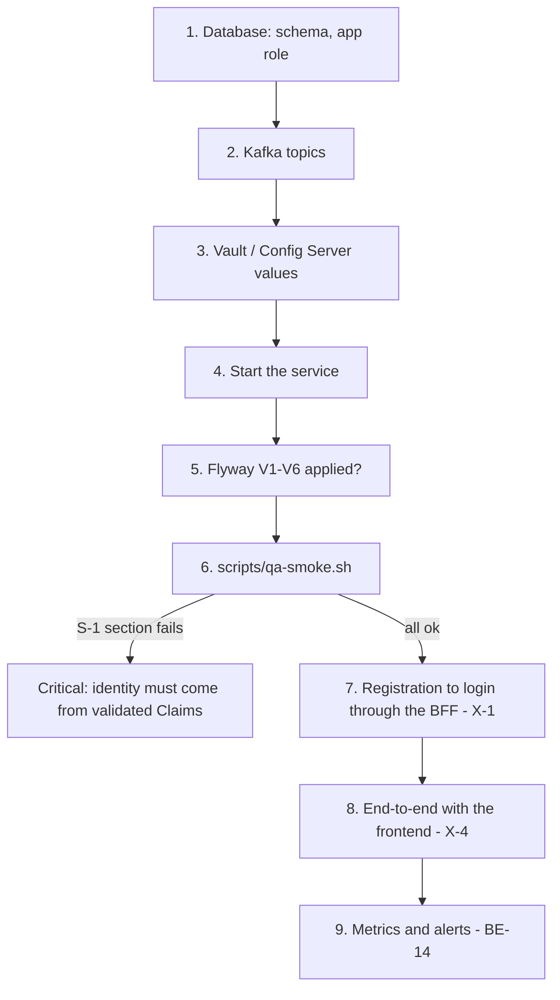

# QA runbook for the MVP (BE-2, BE-3, X-1, X-4, S-1)

What a person with access to the QA environment does to take smartkin-backend from "all tests pass" to "verified in QA". The repository cannot do these steps: they need Vault, Supabase, Kafka and the real PRX security library. Everything that can be prepared in advance is here: the commands, the expected results and a smoke script.

Do the steps in order; each one says how to know it worked.



## 1. Database (BE-2)

1. Bootstrap the schema once, with a role that can create schemas, against the `umdevc` database (not `postgres`):
   `psql "host=<host> port=5432 dbname=umdevc user=postgres" -f docs/db/smartkin_schema_bootstrap.sql`
2. Start the service (step 4). Flyway runs on startup with `SMARTKIN_FLYWAY_USERNAME` (the schema owner) and applies **V1 to V6**. Check:
   `select version, description, success from smartkin.flyway_schema_history order by installed_rank;` → six rows, all `t`.
3. Enable the application role V2 created without login, with a password kept in Vault:
   `psql ... -v app_password="$(vault kv get -field=password <path>)" -c "alter role smartkin_app with login password :'app_password'"`
   Then put that role and password in `SMARTKIN_DB_USERNAME` / `SMARTKIN_DB_PASSWORD` (Vault). The pooler port is `SMARTKIN_DB_PORT` (default 6543); Flyway uses the direct port `SMARTKIN_DB_DIRECT_PORT` (default 5432).
4. Confirm D-2: the 14 tables and 4 enum types of the `smartkin` schema match `docs/decisions/D-2-baseline-schema-and-enum-labels.md`:
   `select count(*) from information_schema.tables where table_schema='smartkin' and table_type='BASE TABLE' and table_name <> 'flyway_schema_history';` → 14.
5. Confirm the API roles are locked out (D-3): as `anon` or `authenticated`, `select * from smartkin.parent` must fail or return no rows.

## 2. Kafka topics (BE-3)

The application does not create topics. Create them before the first request (partitions and replication are a platform choice; the numbers below are a starting point):

| Topic | Purpose | Property |
| --- | --- | --- |
| `smartkin.activity.assigned.v1` | a parent assigned an activity | `KafkaTopicsProperties.activityAssigned` |
| `smartkin.quiz.completed.v1` | a child finished a quiz | `quizCompleted` |
| `smartkin.achievement.earned.v1` | an achievement was awarded | `achievementEarned` |
| `smartkin.events.error.v1` | records that failed every retry | `KAFKA_ERROR_TOPIC` |

```sh
for t in smartkin.activity.assigned.v1 smartkin.quiz.completed.v1 smartkin.achievement.earned.v1 smartkin.events.error.v1; do
  kafka-topics.sh --bootstrap-server "$KAFKA" --create --if-not-exists --topic "$t" --partitions 3 --replication-factor 3
done
kafka-topics.sh --bootstrap-server "$KAFKA" --list | grep '^smartkin\.'      # four lines
```

The consumer group is `smartkin-backend` (`KAFKA_CONSUMER_GROUP_ID`). Grant the service principal read on the three event topics and write on all four.

## 3. Values the service reads (Vault and Config Server)

Nothing below goes in `config/local.env`: an environment variable shadows the Vault value. The full list of placeholders is in `src/main/resources/bootstrap.yml`; the groups are:

| Group | Keys |
| --- | --- |
| Identity and tokens | `APP_TOKEN_SECRET`, `APP_TOKEN_EXPIRATION`, `AUTH_ROLE_ID`, `AUTH_SERVER_URI`, `AUTH_TOKEN_URI`, `AUTH_CERT_URI`, `AUTH_CLIENT_ID`, `AUTH_CLIENT_SECRET` |
| Backbone and mercury clients | `BACKBONE_*` and `MERCURY_*` (`GRANT_TYPE`, `SCOPE`, `CLIENT_ID`, `CLIENT_SECRET`, `USERNAME`, `PASSWORD`), `BACKBONE_URL`, `MERCURY_URL` |
| TLS | `SSL_KEYSTORE_*`, `SSL_TRUSTSTORE_*` |
| PostgreSQL | `SMARTKIN_DB_URI`, `SMARTKIN_DB_USERNAME`, `SMARTKIN_DB_PASSWORD`, optionally `SMARTKIN_FLYWAY_USERNAME` / `_PASSWORD` |
| MongoDB | `SMARTKIN_MONGO_HOST`, `_USERNAME`, `_PASSWORD`, `_DATABASE` |
| Redis | `REVOCATION_REDIS_URL` (token revocation), `CACHE_REDIS_URL` (lesson cache; empty = no cache) |
| Kafka | the Spring Kafka bootstrap servers and the producer settings, plus `KAFKA_CONSUMER_*` (optional) |
| Platform | `VAULT_TOKEN`, `VAULT_SERVER_URL`, `CNFS_URI`, `CNFS_PORT`, `SPRING_BOOT_PROFILE_ACTIVE`, `APP_PORT` |

## 4. Start the service

`docker compose up -d` (needs the `nginx_umdc-net` network) or the platform's own deployment. It is up when `GET /actuator/health/liveness` answers 200. If Vault was unreachable the service starts without its secrets and fails later: read the first lines of the log for the Vault message.

## 5. Smoke test and the S-1 check (X-4, S-1)

`scripts/qa-smoke.sh` needs `curl` and `jq`, and the session tokens of two real users that already exist (the child must have **no** parent or child profile yet):

```sh
BASE_URL=https://smartkin.umdc-qa.tst:8166/smartkin-backend \
PARENT_TOKEN=<token> CHILD_TOKEN=<token of a fresh account> \
EXPIRED_TOKEN=<optional> REVOKED_TOKEN=<optional: a token whose session was closed> \
OTHER_PARENT_TOKEN=<optional second parent> \
CURL_OPTS="--cacert certs/smartkin/prx-internal-ca.crt" \
./scripts/qa-smoke.sh
```

The script prints one line per check and exits non-zero if any fails. Its three sections:

1. **S-1.** For a tampered signature, an unsigned token (`alg: none`), the payload of another user with a valid signature of the first, and (when given) an expired and a revoked token, it calls `GET /parents/me`, `GET /children`, `GET /notifications` and `POST /assignments`. **Every call must answer 401.** If any answers 2xx or 403 the controllers are trusting an unverified `uid`: treat it as a critical vulnerability and read the identity from the validated `Claims` (`SessionJwtService.getTokenClaims`) instead of `JwtUtil.getUidFromToken`, as `docs/SECURITY_REVIEW_MVP.md` explains. (503 is acceptable only if the revocation Redis is down.)
2. **Family (S-2).** The parent creates an invitation; the list never shows the code; a wrong code answers 404; the child accepts (201); the same code cannot be used again (404); a parent cannot accept (409).
3. **Slice.** The parent lists children, topics and activities and assigns an activity; the child sees the assignment, the inbox and their points; with a second parent, another family's child answers 404. The slice needs at least one **active activity with a published lesson** in QA (seed it through MongoDB and `smartkin.activities`).

The script does not take the quiz (that path is covered by `EndToEndFlowContainerTest` on real PostgreSQL, MongoDB and Kafka); do that by hand or with the frontend in step 7.

## 6. Registration to login through the BFF (X-1)

With smartkin-frontend pointed at this backend (its Vault secret `PRX/data/smartkin-frontend/<env>` must carry the smartkin-backend URL): register a user → the verification code arrives by e-mail → confirm it → sign in → the BFF stores the session in Redis → `GET /parents/me` through `/skb/api/v1/general/parents/me`. Repeat with the child account created by a parent (`POST /children/accounts`): the e-mail arrives and the alias signs in.

## 7. End to end with the frontend (X-4)

Parent: create the profile → «Agregar un hijo» (both tabs) → assign a lesson. Child: sign in → the lesson → the quiz (fail once, then pass) → points. Parent: sees the progress, the attempts and the new points. Then provoke a failure to see the error topic: stop MongoDB, submit a quiz, start MongoDB again, and look in `smartkin.events.error.v1` and in the log for `DEAD_LETTERED`.

## 8. Metrics and alerts (BE-14)

The code already counts the problems (`smartkin.events.delivery_failed`, `.dead_lettered`, `.dead_letter_failed`) and logs `DEAD_LETTERED` / `DEAD_LETTER_FAILED`. Two things are left for the platform team, because they change what the service exposes:

- **A registry.** `management.endpoints` exposes only `health`. To scrape the counters add `io.micrometer:micrometer-registry-prometheus`, expose `prometheus` in `management.endpoints.web.exposure.include`, and protect it: the PRX security library answers 401 to everything but the paths `HealthProbeSecurityConfig` opens, so the scraper needs either a token or an internal-only management port. (Decide and apply it in the platform config; it is not changed here.)
- **The rules.** Load `docs/ops/smartkin-events.rules.yml` into Prometheus/Alertmanager: `SmartKinEventDeadLettered` (warning), `SmartKinDeadLetterFailed` (critical) and `SmartKinEventRetriesHigh` (warning). Until the registry exists, alert on the two log lines. `AlertRulesTest` keeps the rules aligned with the metric names in the code.

To verify the alert: repeat the failure of step 7 and confirm `SmartKinEventDeadLettered` fires within 15 minutes.

## Done when

- [ ] Flyway shows V1 to V6 applied and `smartkin_app` can log in (BE-2, BE-3).
- [ ] The four topics exist (BE-3).
- [ ] `scripts/qa-smoke.sh` ends with `failed 0`, including the S-1 section (S-1, X-4).
- [ ] Registration, verification and login work through the BFF (X-1).
- [ ] The end-to-end flow works with the frontend and a failed event reaches the error topic (X-4).
- [ ] The Vault token of commit `2eb6965` in smartkin-frontend was rotated (FE-2, S-4).
- [ ] The alert fires in the failure drill (BE-14).
