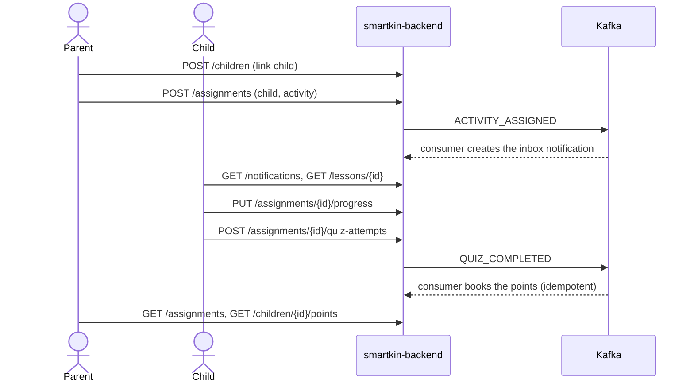

# SmartKin Backend: Technical Guide

## Stack

| Component | Version |
| --- | --- |
| Java | 25 |
| Spring Boot | 4.1.1 |
| Spring Cloud | 2025.1.3 (Config, Bootstrap, OpenFeign, Vault, Eureka client) |
| springdoc | 3.1.0 (`springdoc-openapi-starter-webmvc-ui`) |
| MapStruct | 1.6.3 |
| PostgreSQL JDBC | 42.7.13 |
| Shared libraries | `com.umdc:commons`, `commons-services`, `security-oauth` 0.0.3 (Repsy) |
| Docker base image | `amazoncorretto:25.0.4-alpine3.24` |

Versions are aligned with `zerobound-rest`, `mercury` and `backbone-rest`. Boot-managed starters carry no explicit version.

## Build and test

```bash
mvn clean package            # jar at target/smartkin-backend.jar
mvn verify                   # tests, PMD, CPD and JaCoCo report (target/site/jacoco/jacoco.xml)
mvn test -Dtest=Class#method # single test
```

The private Repsy repository needs `REPSY_ACCOUNT_USER` and `REPSY_ACCOUNT_PASSWORD`; the `com.umdc` libraries can also come
from the local Maven cache.

## Database

PostgreSQL on Supabase, schema `smartkin`, database `umdevc` (shared project with zerobound). User ids come from backbone and are stored as plain UUIDs
(decision D-1). The schema is created and evolved by Flyway (`src/main/resources/db/migration`, decision D-2); Hibernate uses `ddl-auto: none`, so every
entity change needs a new `V<n>__*.sql`.

| Variable | Default | Purpose |
| --- | --- | --- |
| `SMARTKIN_DB_URI` | none | Host only, e.g. `aws-1-us-east-2.pooler.supabase.com` |
| `SMARTKIN_DB_PORT` | 6543 | Transaction pooler used by the application |
| `SMARTKIN_DB_DIRECT_PORT` | 5432 | Connection used by Flyway (session locks) |
| `SMARTKIN_DB_NAME` | `umdevc` | Database |
| `SMARTKIN_DB_SCHEMA` | `smartkin` | Flyway schema and history table location |
| `SMARTKIN_DB_USERNAME`, `SMARTKIN_DB_PASSWORD` | none | Credentials, from Vault |
| `SMARTKIN_DB_POOL_SIZE` | 5 | Hikari maximum pool size |
| `FLYWAY_ENABLED` | `true` | `false` in production when the pipeline applies migrations |

**Access model (D-3).** Only the backend touches the schema. RLS is on for all tables, `anon`/`authenticated`/`service_role` have no privileges, and the application should connect as `smartkin_app`
(DML only). Flyway runs as the schema owner through `SMARTKIN_FLYWAY_USERNAME`/`SMARTKIN_FLYWAY_PASSWORD` (default: the application credentials, fine for local use as the owner). New tables need
`enable row level security` plus a `smartkin_app` policy in their migration. Keep `smartkin` out of Supabase's exposed API schemas.

Create the empty schema with `docs/db/smartkin_schema_bootstrap.sql` (or let Flyway do it through `create-schemas`). Use a dedicated database role for SmartKin.
The config-server file `stage-folder-config/smartkin-backend-*.yml` still carries its own datasource block; the variables above take effect through `bootstrap.yml`,
so remove or align that block when the environment is switched to Supabase.

## MongoDB

MongoDB holds what the relational model should not carry: lesson scene scripts and quizzes, quiz attempts and raw interaction events. Documents are Java records in
`com.umdc.smartkin.mongo.document`; ids that point at PostgreSQL (`topicId`, `assignmentId`) or at backbone (`childId`) are plain UUIDs.

| Collection | Purpose | Indexes |
| --- | --- | --- |
| `lessons` | Scenes, interactions and quiz of a lesson (`status`: DRAFT, PUBLISHED, ARCHIVED) | unique `slug`; `topicId` + `status` |
| `quiz_attempts` | One document per attempt, with answers and score | unique `childId` + `lessonId` + `attemptNumber`; `childId` + `completedAt` desc; `assignmentId` |
| `interaction_events` | Raw taps, drops and choices, kept for analysis | `childId` + `lessonId` + `occurredAt` desc; `attemptId`; TTL on `expiresAt` (0 s) |

`InteractionEventService.record(...)` stamps `expiresAt = now + prx.interaction-events.retention` (`SMARTKIN_INTERACTION_EVENTS_RETENTION`, default 90 days, an assumption to
confirm with the data-protection policy for minors). MongoDB's TTL monitor runs about once a minute, so expiry is not instantaneous.

| Variable | Default | Purpose |
| --- | --- | --- |
| `SMARTKIN_MONGO_HOST` | none | Cluster host (Atlas SRV host, or `host:port` with `SMARTKIN_MONGO_SCHEME=mongodb`) |
| `SMARTKIN_MONGO_SCHEME` | `mongodb+srv` | URI scheme |
| `SMARTKIN_MONGO_DATABASE` | `smartkin` | Database |
| `SMARTKIN_MONGO_USERNAME`, `SMARTKIN_MONGO_PASSWORD` | none | Credentials from Vault; URL-encode special characters |

Index creation at startup needs a user with `createIndex` rights on the database; the unique indexes will fail to build if duplicate data already exists.

## Token revocation (Redis)

backbone-rest writes the `jti` of every revoked session token to Redis as `jti:<jti>` with the token's remaining TTL. `SessionJwtServiceImpl.isValid` accepts a token only if
it is a non-expired `session-token` with a `jti` that is not on that list. Lettuce is used directly (no `spring-boot-starter-data-redis`), as in zerobound-rest.

- The check **fails closed**: if Redis cannot be reached, `SessionValidationUnavailableException` is thrown and `SessionValidationExceptionHandler` answers **503**
  with a `message-error` header; the token is never treated as "not revoked".
- Answers are cached per `jti` for `REVOCATION_CACHE_TTL` (30 s), which is also the worst-case delay before a revocation takes effect; at most `maxCacheEntries` (10 000).
- Lettuce rejects commands while it reconnects, so a Redis outage or restart shows up as 503s for a few seconds, then recovers by itself.

| Variable | Default | Purpose |
| --- | --- | --- |
| `REVOCATION_ENABLED` | `true` | `false` skips the check (local development only) |
| `REVOCATION_REDIS_URL` | none (required) | `redis[s]://[user:password@]host:port/db`, the same Redis and db index backbone-rest uses |
| `REVOCATION_CACHE_TTL` | `30s` | Cache of answers |
| `REVOCATION_REDIS_TIMEOUT` | `2s` | Connect and command timeout |

Tokens signed by SmartKin itself carry a `jti` too, but only backbone's deny-list is consulted; revoking them requires writing `jti:<value>` keys the same way backbone does.

## Lesson catalog cache (Redis)

`LessonCatalogService.publishedLessons(topicId)` returns `LessonSummary` records (id, slug, topic, title, description, locale, version; no scenes or quiz). With a cache Redis
configured it checks `smartkin:catalog:topic:<topicId>` first; on a miss it reads MongoDB (`PUBLISHED` lessons only) and stores the list with a TTL. Unlike the revocation check, the
cache **fails open**: an unreachable or slow Redis, or an unreadable entry, is just a miss. Whoever publishes, edits or archives a lesson must call `evict(topicId)`; otherwise the
list can be stale for up to the TTL.

| Variable | Default | Purpose |
| --- | --- | --- |
| `CACHE_REDIS_URL` | empty (cache off) | `redis[s]://[user:password@]host:port/db` of SmartKin's own cache; may be the revocation Redis on a different db index, but not backbone's keys |
| `CACHE_LESSON_CATALOG_TTL` | `10m` | Lifetime of a topic's list |
| `CACHE_REDIS_TIMEOUT` | `500ms` | Connect and command timeout |

**Pending (frontend):** keeping the BFF session in Redis belongs to `smartkin-frontend` (Express server) and waits for NG-5; it is not part of this repository.

## Kafka events

Two kinds of messages leave the service. Email requests go to mercury's topic (`EmailMessageProducerService`). Domain events go through `SmartKinEventPublisher` to the topics below
(contract and rules in `docs/decisions/D-4-domain-events-and-topics.md`).

| Event | Topic | Key | Published by |
| --- | --- | --- | --- |
| `ACTIVITY_ASSIGNED` | `smartkin.activity.assigned.v1` | child id | `publisher.activityAssigned(payload)` |
| `QUIZ_COMPLETED` | `smartkin.quiz.completed.v1` | child id | `publisher.quizCompleted(payload)` |
| `ACHIEVEMENT_EARNED` | `smartkin.achievement.earned.v1` | child id | `publisher.achievementEarned(payload)` |

Messages are JSON envelopes (`eventId`, `type`, `schemaVersion`, `occurredAt`, `subjectId`, `payload`). Delivery is at least once and not transactional with the databases; consumers dedupe
by `eventId` and ignore unknown fields. `publish` returns a `CompletableFuture`, which completes exceptionally when Kafka rejects the record. Topics must be created by the platform team;
the application does not create them. Producer settings come from `prx.bootstrap.server.url` and `prx.bootstrap.server.port` (`KafkaProducerConfig`).

### Consuming events and failures (KF-2, KF-3)

`SmartKinEventListener` has one `@KafkaListener` per topic (names from `prx.kafka.topics.*`, group `prx.kafka.consumer.group-id`) and hands the parsed event to
`EventEffectsService`, one transaction per event:

| Event | Effect |
| --- | --- |
| `ACTIVITY_ASSIGNED` | `ASSIGNMENT` notification for the child, related entity = assignment id |
| `QUIZ_COMPLETED` | if `passed` and `score > 0`: `EARN` point row (source `QUIZ`, source id = attempt id, amount = score) and `child.total_points += score` |
| `ACHIEVEMENT_EARNED` | if `pointsValue > 0`: `EARN` point row (source `ACHIEVEMENT`, source id = child achievement id); `ACHIEVEMENT` notification |

The points rule (points = quiz score) is an assumption of this task; change it in `EventEffectsService.onQuizCompleted`. Each effect checks first whether it already exists
(`PointRepository.existsBySourceType...`, `NotificationRepository.existsByUserId...`); the partial unique indexes of `V3` guarantee it if two consumers race. A child that is not
registered in SmartKin makes the event fail (so it is retried and finally dead-lettered) instead of being dropped.

Failures are handled by `KafkaConsumerConfig`'s `DefaultErrorHandler`: exponential back-off (`prx.kafka.consumer.max-attempts` total tries, `initial-interval`, `multiplier`, `max-interval`),
then `DeadLetterPublishingRecoverer` publishes the original key and value to `prx.kafka.consumer.error-topic` (one topic for all events, partition chosen by Kafka) with the standard
`kafka_dlt-*` headers (exception class, message, stack trace, original topic/partition/offset). `JacksonException` and `IllegalArgumentException` are not retried. Retries block the
partition (ordering per child is preserved) for at most the sum of the delays, about 7s with the defaults. Nothing reads the error topic automatically: replay is manual
(re-publish the value to the original topic once the cause is fixed; the idempotent effects make that safe).

Open points: events are not published by any service yet, so the consumers are exercised only by tests; emails for these events (which need the recipient's address from backbone) are not sent.

## Container images

Same scheme as mercury, backbone-rest and zerobound-rest; the choices that differ are explained here.

| File | Purpose |
| --- | --- |
| `Dockerfile` | JVM image. Stage 1 extracts the Spring Boot jar into layers (`-Djarmode=tools extract --layers`); stage 2 is `amazoncorretto:25.0.4-alpine3.24` with the layers, `docker-entrypoint.sh`, user `jvapps`, `HEALTHCHECK` and port 8166. Needs `target/smartkin-backend.jar` (the build context allowlist is `.dockerignore`). |
| `docker-entrypoint.sh` | `exec java` so the JVM is PID 1 and gets SIGTERM; `UseCompactObjectHeaders`, `MaxRAMPercentage=75`, `ExitOnOutOfMemoryError`, `-Dspring.cloud.vault.enabled=${VAULT_ENABLED}`, then `${JAVA_OPTS}` last so a deployment can override. |
| `Dockerfile.native` | GraalVM Community 25 on Debian 12 (not the Oracle Linux image: its glibc needs x86-64-v3), Maven 3.9.14, native profile, runtime on `debian:12-slim` with `curl` for the probe. Secrets: `maven_settings` (Repsy credentials, optional) and `prx_internal_ca` (optional); build context `umdc-local` re-seeds the `com.umdc` artifacts when Repsy is down. |
| `config/native.env` | Dummy values for every `${VAR}` without default, so Spring AOT can refresh the context. `SPRING_BOOT_PROFILE_ACTIVE` is empty on purpose (AOT bakes active profiles into the binary). Never a deployment config. |
| `config/local.env`, `secrets/local.env` | Versioned bootstrap identity vs. git-ignored `VAULT_TOKEN`. Do not add Vault-provided variables here: an environment variable shadows Vault. |
| `docker-compose.yml` | One service, IP `172.22.0.12` (9 = backbone, 10 = mercury, 11 = zerobound), `extra_hosts` for the `*.umdc-qa.tst` names, `read_only` + `tmpfs /tmp`, `no-new-privileges`, `stop_grace_period: 30s`. |

**TLS material.** `certs/smartkin/` is git-ignored and is copied onto the classpath by `pom.xml`, because the TLS bundle and the security library read `classpath:` names. `umdc.security.keystore` and `truststore` take the same files and must have no `classpath:` prefix (the library loads them with `getResourceAsStream` and a missing file silently becomes an empty store: "trustAnchors parameter must be non-empty"). The truststore must hold a trusted certificate entry; a keystore with only a private key is not a truststore. In security-oauth 0.0.3 the keystore/truststore arguments are not swapped (mercury documents a swap in 0.0.1).

**Health.** `management.endpoints.web.exposure.include: health` with probes enabled; the image and compose probe `/actuator/health/liveness`, which does not depend on Postgres, MongoDB, Redis or Kafka. The library's filter chain answers 401 to everything but Swagger, so `HealthProbeSecurityConfig` adds a first-order chain for `/actuator/health/**` only (`HealthProbeSecurityConfigTest`).

**What was verified.** The JVM image was built and run with `config/native.env` plus overrides (profile empty, bootstrap on, Eureka off, Mongo index creation off, Kafka consumers off, no Hikari fail-fast): non-root `jvapps`, read-only root with `/tmp` tmpfs and `no-new-privileges`, health `healthy`, `/api/v1/**` and `/actuator/env` still 401, `docker stop` completes in well under a second with a graceful Tomcat shutdown. Against real Vault, Supabase, Atlas, Redis and Kafka it was **not** run.

**Native image: builds, does not start yet.** `docker build -f Dockerfile.native` succeeds (Spring AOT and `native-image` pass; about 3.5 minutes with `NATIVE_QUICK_BUILD=true`, 596 MB image) but the binary stops at start with `no ServletWebServerFactory bean defined in the context`: the AOT-generated context is empty. Probable cause, not confirmed: the application relies on the legacy Spring Cloud bootstrap context (`bootstrap.yml`, `spring-cloud-starter-bootstrap`), which Spring AOT does not support; mercury, backbone-rest and zerobound-rest configure Vault and the Config Server through `spring.config.import` instead. Enabling the bootstrap context at build time (`SPRING_CLOUD_BOOTSTRAP_ENABLED=true` in `config/native.env`) did not change the result. Making the native image work means moving that configuration to `application.yml` + `spring.config.import`, a change of its own. Until then `Dockerfile.native` is experimental and the JVM image is the one to deploy.

**Findings from the smoke test** (all fixed except the last): the `prx.*` library properties (see Library property names), the missing `umdc.security.keystore`/`truststore`, the base64 requirement of `APP_TOKEN_SECRET`, and the 401 on health. Not fixed: with `spring.data.mongodb.auto-index-creation: true` the application does not start if Atlas is unreachable (a 30 s server-selection timeout); and Eureka registration still fails with `No qualifying bean ... TransportClientFactories` when `eureka.client.enabled` is true (adding `eureka.client.tls` and `eureka-client-jersey3`/Jersey did not fix it), so the smoke test and AOT run with `EUREKA_CLIENT_ENABLED=false`. Check what the Config Server sets for Eureka in QA before deploying.

## Continuous integration

`.github/workflows/ci.yml` runs `mvn -B verify` on JDK 25 (Temurin) for pushes and pull requests to `main` and `development`, and uploads
`target/site/jacoco/` as the `backend-coverage` artifact. Optional repository secrets `REPSY_ACCOUNT_USER` and `REPSY_ACCOUNT_PASSWORD` are passed
as environment variables for the private Repsy repository. The workflow does not build the Docker image because the certificates copied by the
`Dockerfile` (`src/main/resources/*.crt`, `keystore.jks`) are not in the repository.

## Coverage policy

- Every task must reach **85%** line and branch coverage on the classes and methods it adds or changes.
- `jacoco.minimum.coverage` is 0.85 and the package-level JaCoCo check fails the build (`mvn verify`).
- The check skips code with no logic of its own: `*Application`, `config/**`, `jpa/domain/**` (entities), `jpa/repository/**` and the generated
  `mapper/*Impl` classes. The entity model is verified by `JpaMappingContainerTest` instead.
- Last measurement (JV-6): 99.5% lines, 99.0% branches and 99.1% methods on the gated code.

## Tests

| Test | What it covers |
| --- | --- |
| `UserServiceImplTest`, `UserRegisterServiceImplTest`, `AuthServiceImplTest` | Business flows with mocked Feign clients, mappers and Kafka producer |
| `SessionJwtServiceImplTest`, `JwtUtilTest` | Token signing, claims and parsing |
| `UserControllersTest` | Delegation, route mapping with MockMvc and the `*Api` default methods |
| `MappersTest` | MapStruct mappings and their default methods |
| `FeignConfigurersTest` | Bearer token interceptors against a local HTTP server that plays the token endpoint |
| `TransferObjectsTest`, `EmailMessageProducerServiceImplTest` | `toString` and the Jackson 3 contract, including the snake_case payload sent to mercury |
| `MongoCollectionsContainerTest`, `InteractionEventServiceTest` | Documents, repositories, unique and TTL indexes on MongoDB 7 (Testcontainers) and the retention stamp |
| `RedisRevocationCheckerTest`, `RedisConnectorTest`, `RevocationWiringTest` | Deny-list lookups against Redis 7 (Testcontainers): cache, eviction, fail-closed, reconnection and bean selection |
| `LessonCatalogServiceTest`, `RedisLessonCatalogCacheTest` | Cache-aside flow, JSON round trip, TTL, eviction, fail-open and bean selection (Redis 7 in Testcontainers) |
| `DirectAccessRestrictionContainerTest` | V2 on PostgreSQL 17 with Supabase-like roles: RLS on every table, application role DML only, API roles locked out |
| `SmartKinEventTest`, `SmartKinEventPublisherTest`, `KafkaEventsContainerTest` | Envelope and payload JSON, topic names and overrides, send/failed-send behaviour and a real round trip through Kafka 4.0 (the Testcontainers `KafkaContainer` does not start `apache/kafka:3.9.0`) |
| `JpaMappingContainerTest` | Flyway baseline on a PostgreSQL 17 Testcontainer, CRUD round trips of the 13 entities, the 4 enums and the cascade |

| `OpenApiContractTest` | `docs/api/openapi-v1.yaml` is well formed and keeps its invariants |

Docker must be running for `JpaMappingContainerTest`.
Shared builders live in `src/test/java/com/umdc/smartkin/support/TestData.java`.

## MVP API contract (X-2)

The API of the MVP slice is defined in `docs/api/openapi-v1.yaml` (OpenAPI 3.0.3, 25 operations) before it is implemented; the design choices are in `docs/decisions/D-6-mvp-api-contract.md`.
Nothing in the running service changes with this ticket: the contract adds no controller, so the existing `/api/v1/users` and `/api/v1/user-register` behavior is untouched.

| Tag | Operations | Implemented by |
| --- | --- | --- |
| parents, children | `GET/PUT /parents/me`, `GET/POST /children`, `GET/PUT /children/{childId}` | BE-4, BE-5 |
| catalog | `GET /topics`, `/topics/{topicId}/lessons`, `/lessons/{lessonId}`, `/activities`, `/activities/{activityId}` | BE-6 |
| assignments | `GET/POST /assignments`, `GET /assignments/{id}`, `GET/PUT .../progress`, `PUT .../feedback` | BE-7, BE-8 |
| quiz | `GET/POST /assignments/{id}/quiz-attempts` | BE-9 |
| rewards | `GET /children/{childId}/points`, `/children/{childId}/achievements` | BE-10, BE-11 |
| notifications | `GET /notifications`, `/notifications/unread-count`, `POST .../read`, `/notifications/read-all` | BE-12 |

Every operation needs the `session-token` header. Ownership comes from the token (a parent sees only their children, a child only themselves; 404 hides other families' ids). The quiz sent to clients never carries which option is correct.



`OpenApiContractTest` checks that the file parses, every `$ref` resolves, operation ids are unique and each has a 2xx response, options carry no `correct` flag, the paged lists share `PageMeta` and the existing user endpoints are not redefined.
The frontend generates its types from this file (X-3).

## Spring Boot 4 migration notes

- `@EntityScan` lives in `org.springframework.boot.persistence.autoconfigure`.
- Jackson 3 uses `tools.jackson.*` (`ObjectMapper`, `JacksonException`, unchecked). Jackson annotations stay in `com.fasterxml.jackson.annotation`.
- javac no longer finds annotation processors on the classpath: `maven-compiler-plugin` lists `mapstruct-processor` and
  `spring-boot-configuration-processor` in `annotationProcessorPaths`.
- Surefire passes JaCoCo's `${argLine}` plus the Mockito agent; ASM 9.10.1 is required to read Java 25 bytecode.

## Feign client URLs

`@FeignClient(url = "${prx.clients.backbone.url}")` and `${prx.clients.mercury.url}` are resolved from `bootstrap.yml`, where
`BACKBONE_URL` and `MERCURY_URL` override the QA defaults. `FeignClientUrlConfigTest` checks the placeholders, the defaults and the override.

## Library property names

The com.umdc libraries bind `umdc.*` properties, not the old `prx.*` ones: `umdc.security.auth.clients` (outbound clients backbone and mercury), `umdc.security.jwt.{secret,expirationMs}`, `umdc.api.endpoint`, `umdc.backbone.base-url`, `umdc.management.clientRoles`, `umdc.logging.trace.enabled`. `LibraryPropertiesBindingTest` binds them from `bootstrap.yml`. The application's own settings keep the `prx.*` prefix (`prx.clients.*`, `prx.security.revocation.*`, `prx.cache.*`, `prx.kafka.*`, `prx.smartkin.*`).

## Known gaps

- The service starts only with the full environment (Vault, Config Server, SSL bundle, OAuth clients); startup with a complete
  environment was not verified in this task.
- The Docker image was not built in this task.
- The error topic must exist before the first failure (the application does not create topics), and nothing alerts on it yet.
- The enum labels (D-2) and the baseline DDL are derived from the entities and need confirmation against any existing `smartkin` schema in `umdevc`.
- Flyway and the Supabase connection were exercised only against a Testcontainers PostgreSQL, not against Supabase.
