# SmartKin Backend: Technical Guide

## Stack

| Component | Version |
| --- | --- |
| Java | 25 |
| Spring Boot | 4.1.1 |
| Spring Cloud | 2025.1.3 (Config, OpenFeign, Vault, Eureka client; no bootstrap context) |
| springdoc | 3.2.0 (`springdoc-openapi-starter-webmvc-ui`) |
| MapStruct | 1.6.3 |
| PostgreSQL JDBC | 42.7.14 |
| Shared libraries | `com.umdc:commons`, `commons-services`, `security-oauth` 0.0.3 (Repsy) |
| Docker base image | `amazoncorretto:25.0.4-alpine3.24` |

Versions are aligned with `zerobound-rest`, `mercury` and `backbone-rest`. Boot-managed starters carry no explicit version.

## Build and test

```bash
mvn clean package            # jar at target/smartkin-backend.jar
mvn verify                   # tests, PMD, CPD and JaCoCo report (target/site/jacoco/jacoco.xml)
mvn test -Dtest=Class#method # single test
```

The private Repsy repository needs `REPSY_ACCOUNT_USER` and `REPSY_ACCOUNT_PASSWORD`; the `com.umdc` libraries can also come
from the local Maven cache.

## Configuration loading (`spring.config.import`)

All configuration is in `src/main/resources/application.yml` (it used to be `bootstrap.yml`). Vault and the Config Server are not read by the legacy Spring Cloud bootstrap context any more: `spring-cloud-starter-bootstrap` is gone and `spring.config.import: "optional:vault://,optional:configserver:"` loads both before the application context exists, the way mercury, backbone-rest and zerobound-rest do. The reason is GraalVM: the bootstrap context starts a second, nested `SpringApplication`, Spring AOT captured that one instead of the real application, and the native binary stopped with `no ServletWebServerFactory bean defined in the context`. The `spring.cloud.vault.*` and `spring.cloud.config.*` properties are the same as before; only the loading mechanism changed.

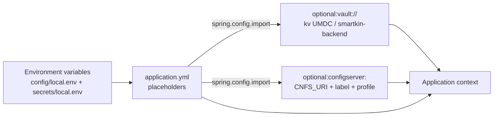

Precedence, from lowest to highest: `application.yml`, Vault, Config Server; an environment variable beats all of them, which is why Vault-owned values must never appear in `config/local.env`. New variables: `VAULT_KV_BACKEND` (default `UMDC`) and `VAULT_KV_CONTEXT` (default the application name) choose the Vault path `<backend>/<context>[/<profile>]`; `VAULT_ENABLED` (default `false`) switches Vault on; `CNFS_URI` defaults to `http://localhost:8888` and `SPRING_CLOUD_CONFIG_LABEL`/`SPRING_BOOT_PROFILE_ACTIVE` default to empty. `SPRING_BOOT_CLOUD_BOOTSTRAP_ENABLED` and `SPRING_CLOUD_BOOTSTRAP_ENABLED` no longer exist. `spring.cloud.config.port` was removed (the client has no such field; `CNFS_PORT` is ignored). Both clients now trust the PRX internal CA from `classpath:${SSL_TRUSTSTORE_LOCATION}` (`spring.cloud.vault.ssl` and `spring.cloud.config.tls`), because the native image has no JVM `cacerts` import of it.

`NativeRuntimeHints` registers the properties types bound during the import (`VaultProperties`, `VaultKeyValueBackendProperties`, `ConfigClientProperties`, `RetryProperties`, `TlsProperties` and their nested classes), which AOT cannot see because they are bound before the context exists (`NativeRuntimeHintsTest`).

## Authentication (`SessionTokenSecurityConfig`)

Same model as mercury and zerobound-rest. The Spring Security chain (`SessionTokenSecurityConfig`) lets `umdc.api.endpoint` + `/**` (`/api/v1/**`), the health probes, `/error` and Swagger through and denies everything else; the authentication itself happens at the MVC layer in security-oauth's `SessionJwtInterceptor`, which reads the `session-token` header and asks `SessionJwtServiceImpl.isValid` (HMAC signature with `APP_TOKEN_SECRET`, expiry, token type `session-token`, and the `jti` revocation list in Redis; it fails closed with 503 when the list is down). Anything else answers 401.

`SmartKinBackendApplication` excludes the library's `com.umdc.security.config.SecurityConfig` from the component scan (`SmartKinBackendApplicationScanTest`). That class is a decommissioned Keycloak-style JWT resource server: it needs a `jwk-set-uri`, builds a `RestTemplate` whose keystore it reads with `ClassLoader.getResourceAsStream` (classpath only, which the GraalVM binary does not embed), and answers 401 to a request that carries a `session-token` and no bearer token, which is what every client sends. The `spring.security.oauth2.*` and `umdc.security.keystore/truststore` properties and the OAuth2 resource-server autoconfiguration were removed with it; `HealthProbeSecurityConfig` was folded into the new class.

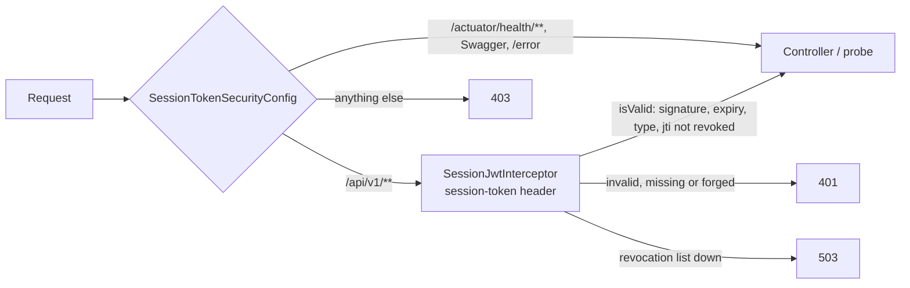

**Verified on the JVM jar** (a throwaway PostgreSQL, a token signed with the configured secret): a valid `session-token` reaches the repository (before the change the same token answered 401 from the library's chain); a token signed with another key, an unsigned one (`alg: none`), an expired one and a request with no token answer 401; `/actuator/health/liveness` is `UP` and `/actuator/env` is 403. This is the local half of finding S-1 in `docs/SECURITY_REVIEW_MVP.md`; the check against the real environment (Redis revocation list, the PRX library as deployed) still belongs to `scripts/qa-smoke.sh` in QA.

## Environment setup scripts

Three scripts bring an empty environment to the point where the service can start. Run them in this order; each is idempotent and takes its secrets from the environment (Vault), never from a file in the repository.

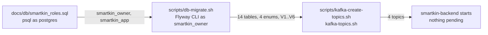

| Script | Needs | Does | Refuses |
| --- | --- | --- | --- |
| `scripts/db-migrate.sh [info\|validate\|migrate]` | Docker, `SMARTKIN_DB_URI`, `SMARTKIN_FLYWAY_USERNAME`, `SMARTKIN_FLYWAY_PASSWORD` | runs the files of `src/main/resources/db/migration` with the Flyway CLI image `flyway/flyway:12.4.0` (the version Spring Boot 4.1.1 brings), schema `smartkin`, `validateOnMigrate`; the password reaches the container through the environment, not a command line; `info` (default) changes nothing | the pooler port 6543 (migrations need session locks), the `postgres` user (the tables would belong to it) unless `ALLOW_ADMIN_USER=1`, any other command |
| `scripts/kafka-create-topics.sh [--dry-run]` | Docker (or `KAFKA_TOPICS_BIN`), `KAFKA_BOOTSTRAP_SERVERS`, optionally `KAFKA_CLIENT_PROPERTIES` | creates `smartkin.activity.assigned.v1`, `smartkin.quiz.completed.v1`, `smartkin.achievement.earned.v1` and `smartkin.events.error.v1` (same names and overrides as the service: `TOPIC_*`, `KAFKA_ERROR_TOPIC`) with `--if-not-exists`, then describes each and fails if one is missing or has fewer partitions than `PARTITIONS` (default 3, `REPLICATION_FACTOR` default 3) | a missing bootstrap list, a missing properties file; an existing topic is never altered |

**Verified** (throwaway containers on a Docker network, 2026-10-25). Database: PostgreSQL 17, `smartkin_roles.sql`, then `db-migrate.sh migrate`: six migrations applied, 14 tables and 4 enums (decision D-2), all owned by `smartkin_owner`; a second run says "up to date"; `validate` passes; the application role reads and cannot create tables; the service jar then starts with `FLYWAY_ENABLED=true`, validates the six migrations from the CLI-created history, finds nothing pending and answers 404 (no profile) from the real tables. Kafka: Apache Kafka 4.2.0 single node: the four topics are created with 3 partitions, a second run changes nothing, a replication factor of 3 on one broker fails with exit code 1, expecting more partitions than exist fails, and a message round-trips on `smartkin.activity.assigned.v1`. **Not verified:** Supabase (TLS parameters, pooler user suffix, platform limits on role management) and the real broker (SASL/SSL client properties, ACLs for the service principal: read on the three event topics, write on all four).

## Database

PostgreSQL on Supabase, schema `smartkin`, database `umdevc` (shared project with zerobound). User ids come from backbone and are stored as plain UUIDs
(decision D-1). The schema is created and evolved by Flyway (`src/main/resources/db/migration`, decision D-2); Hibernate uses `ddl-auto: none`, so every
entity change needs a new `V<n>__*.sql`.

| Variable | Default | Purpose |
| --- | --- | --- |
| `SMARTKIN_DB_URI` | none | Host only, e.g. `aws-1-us-east-2.pooler.supabase.com` |
| `SMARTKIN_DB_PORT` | 6543 | Transaction pooler used by the application |
| `SMARTKIN_DB_DIRECT_PORT` | 5432 | Connection used by Flyway (session locks) |
| `SMARTKIN_DB_NAME` | `umdevc` | Database |
| `SMARTKIN_DB_SCHEMA` | `smartkin` | Flyway schema and history table location |
| `SMARTKIN_DB_USERNAME`, `SMARTKIN_DB_PASSWORD` | none | Credentials, from Vault |
| `SMARTKIN_DB_POOL_SIZE` | 5 | Hikari maximum pool size |
| `FLYWAY_ENABLED` | `true` | `false` in production when the pipeline applies migrations |

**Database roles (`docs/db/smartkin_roles.sql`).** Two login roles, created by one idempotent psql script (run it as `postgres` against `umdevc`, once per environment and again to rotate a password):

| Role | Used by | Can | Cannot |
| --- | --- | --- | --- |
| `smartkin_owner` | Flyway (`SMARTKIN_FLYWAY_USERNAME` / `_PASSWORD`) | own the `smartkin` schema, run DDL and migrations; not subject to RLS as owner | be superuser, create roles or databases, bypass RLS |
| `smartkin_app` | the service (`SMARTKIN_DB_USERNAME` / `_PASSWORD`) | `SELECT`/`INSERT`/`UPDATE`/`DELETE` on the tables, `USAGE`/`SELECT` on sequences, through the `smartkin_app_all` policy | DDL, `TRUNCATE`, create roles, bypass RLS |

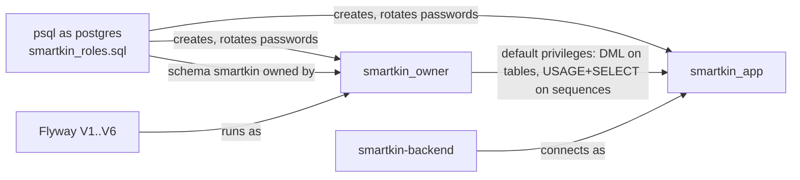

There are two versions of the same script. `smartkin_roles.sql` **needs psql** (it uses `\if`, `\set`, `\gexec` and `-v`): the passwords are psql variables (`-v owner_password=... -v app_password=...`, from Vault) and never touch the file. `smartkin_roles_sql_editor.sql` is for clients that are not psql (DataGrip, DBeaver, pgAdmin, the Supabase SQL editor, which run a file as plain SQL and ignore the meta-commands): it is one `do` block with no meta-commands, the operator edits the two passwords and the expected database at its top, and it stops with a message while they are still `CHANGE_ME_*`. Its passwords are part of the statement, so they can reach the client's history and the server log; use psql when you can. Run in a SQL editor, `smartkin_roles.sql` executes only its first guard and answers that the password is required, with a pointer to the editor version. `-v expected_database=umdevc` aborts when the connection is to another database. If the tables were created by another role (the schema was provisioned as `postgres`), the script moves the tables, sequences and enum types to `smartkin_owner`. `DatabaseRolesScriptContainerTest` runs the psql version with real psql and the editor version over JDBC: attributes of both roles, every migration as the owner, DML yes and DDL/`TRUNCATE`/`CREATE ROLE` no for the application role, re-run and password rotation, the ownership hand-over, the missing-password and wrong-database failures.

**Access model (D-3).** Only the backend touches the schema. RLS is on for all tables, `anon`/`authenticated`/`service_role` have no privileges, and the application should connect as `smartkin_app`
(DML only). Flyway runs as the schema owner through `SMARTKIN_FLYWAY_USERNAME`/`SMARTKIN_FLYWAY_PASSWORD` (default: the application credentials, fine for local use as the owner). New tables need
`enable row level security` plus a `smartkin_app` policy in their migration. Keep `smartkin` out of Supabase's exposed API schemas.

Create the empty schema with `docs/db/smartkin_schema_bootstrap.sql` (or let Flyway do it through `create-schemas`). Use a dedicated database role for SmartKin.
The config-server file `stage-folder-config/smartkin-backend-*.yml` still carries its own datasource block; the variables above take effect through `application.yml`,
so remove or align that block when the environment is switched to Supabase.

## MongoDB

MongoDB holds what the relational model should not carry: lesson scene scripts and quizzes, quiz attempts and raw interaction events. Documents are Java records in
`com.umdc.smartkin.mongo.document`; ids that point at PostgreSQL (`topicId`, `assignmentId`) or at backbone (`childId`) are plain UUIDs.

| Collection | Purpose | Indexes |
| --- | --- | --- |
| `lessons` | Scenes, interactions and quiz of a lesson (`status`: DRAFT, PUBLISHED, ARCHIVED) | unique `slug`; `topicId` + `status` |
| `quiz_attempts` | One document per attempt, with answers and score | unique `childId` + `lessonId` + `attemptNumber`; `childId` + `completedAt` desc; `assignmentId` |
| `interaction_events` | Raw taps, drops and choices, kept for analysis | `childId` + `lessonId` + `occurredAt` desc; `attemptId`; TTL on `expiresAt` (0 s) |

`InteractionEventService.record(...)` stamps `expiresAt = now + prx.interaction-events.retention` (`SMARTKIN_INTERACTION_EVENTS_RETENTION`, default 90 days, an assumption to
confirm with the data-protection policy for minors). MongoDB's TTL monitor runs about once a minute, so expiry is not instantaneous.

| Variable | Default | Purpose |
| --- | --- | --- |
| `SMARTKIN_MONGO_HOST` | none | Cluster host (Atlas SRV host, or `host:port` with `SMARTKIN_MONGO_SCHEME=mongodb`) |
| `SMARTKIN_MONGO_SCHEME` | `mongodb+srv` | URI scheme |
| `SMARTKIN_MONGO_DATABASE` | `smartkin` | Database |
| `SMARTKIN_MONGO_USERNAME`, `SMARTKIN_MONGO_PASSWORD` | none | Credentials from Vault; URL-encode special characters |

Index creation at startup needs a user with `createIndex` rights on the database; the unique indexes will fail to build if duplicate data already exists.

## Token revocation (Redis)

backbone-rest writes the `jti` of every revoked session token to Redis as `jti:<jti>` with the token's remaining TTL. `SessionJwtServiceImpl.isValid` accepts a token only if
it is a non-expired `session-token` with a `jti` that is not on that list. Lettuce is used directly (no `spring-boot-starter-data-redis`), as in zerobound-rest.

- The check **fails closed**: if Redis cannot be reached, `SessionValidationUnavailableException` is thrown and `SessionValidationExceptionHandler` answers **503**
  with a `message-error` header; the token is never treated as "not revoked".
- Answers are cached per `jti` for `REVOCATION_CACHE_TTL` (30 s), which is also the worst-case delay before a revocation takes effect; at most `maxCacheEntries` (10 000).
- Lettuce rejects commands while it reconnects, so a Redis outage or restart shows up as 503s for a few seconds, then recovers by itself.

| Variable | Default | Purpose |
| --- | --- | --- |
| `REVOCATION_ENABLED` | `true` | `false` skips the check (local development only) |
| `REVOCATION_REDIS_URL` | none (required) | `redis[s]://[user:password@]host:port/db`, the same Redis and db index backbone-rest uses |
| `REVOCATION_CACHE_TTL` | `30s` | Cache of answers |
| `REVOCATION_REDIS_TIMEOUT` | `2s` | Connect and command timeout |

Tokens signed by SmartKin itself carry a `jti` too, but only backbone's deny-list is consulted; revoking them requires writing `jti:<value>` keys the same way backbone does.

## Lesson catalog cache (Redis)

`LessonCatalogService.publishedLessons(topicId)` returns `LessonSummary` records (id, slug, topic, title, description, locale, version; no scenes or quiz). With a cache Redis
configured it checks `smartkin:catalog:topic:<topicId>` first; on a miss it reads MongoDB (`PUBLISHED` lessons only) and stores the list with a TTL. Unlike the revocation check, the
cache **fails open**: an unreachable or slow Redis, or an unreadable entry, is just a miss. Whoever publishes, edits or archives a lesson must call `evict(topicId)`; otherwise the
list can be stale for up to the TTL.

| Variable | Default | Purpose |
| --- | --- | --- |
| `CACHE_REDIS_URL` | empty (cache off) | `redis[s]://[user:password@]host:port/db` of SmartKin's own cache; may be the revocation Redis on a different db index, but not backbone's keys |
| `CACHE_LESSON_CATALOG_TTL` | `10m` | Lifetime of a topic's list |
| `CACHE_REDIS_TIMEOUT` | `500ms` | Connect and command timeout |

**Pending (frontend):** keeping the BFF session in Redis belongs to `smartkin-frontend` (Express server) and waits for NG-5; it is not part of this repository.

## Kafka events

Two kinds of messages leave the service. Email requests go to mercury's topic (`EmailMessageProducerService`). Domain events go through `SmartKinEventPublisher` to the topics below
(contract and rules in `docs/decisions/D-4-domain-events-and-topics.md`).

| Event | Topic | Key | Published by |
| --- | --- | --- | --- |
| `ACTIVITY_ASSIGNED` | `smartkin.activity.assigned.v1` | child id | `publisher.activityAssigned(payload)` |
| `QUIZ_COMPLETED` | `smartkin.quiz.completed.v1` | child id | `publisher.quizCompleted(payload)` |
| `ACHIEVEMENT_EARNED` | `smartkin.achievement.earned.v1` | child id | `publisher.achievementEarned(payload)` |

Messages are JSON envelopes (`eventId`, `type`, `schemaVersion`, `occurredAt`, `subjectId`, `payload`). Delivery is at least once and not transactional with the databases; consumers dedupe
by `eventId` and ignore unknown fields. `publish` returns a `CompletableFuture`, which completes exceptionally when Kafka rejects the record. Topics must be created by the platform team;
the application does not create them. Producer settings come from `prx.bootstrap.server.url` and `prx.bootstrap.server.port` (`KafkaProducerConfig`).

### Consuming events and failures (KF-2, KF-3)

`SmartKinEventListener` has one `@KafkaListener` per topic (names from `prx.kafka.topics.*`, group `prx.kafka.consumer.group-id`) and hands the parsed event to
`EventEffectsService`, one transaction per event:

| Event | Effect |
| --- | --- |
| `ACTIVITY_ASSIGNED` | `ASSIGNMENT` notification for the child, related entity = assignment id |
| `QUIZ_COMPLETED` | if `passed` and `score > 0`: `EARN` point row (source `QUIZ`, source id = attempt id, amount = score) and `child.total_points += score` |
| `ACHIEVEMENT_EARNED` | if `pointsValue > 0`: `EARN` point row (source `ACHIEVEMENT`, source id = child achievement id); `ACHIEVEMENT` notification |

The points rule (points = quiz score) is an assumption of this task; change it in `EventEffectsService.onQuizCompleted`. Each effect checks first whether it already exists
(`PointRepository.existsBySourceType...`, `NotificationRepository.existsByUserId...`); the partial unique indexes of `V3` guarantee it if two consumers race. A child that is not
registered in SmartKin makes the event fail (so it is retried and finally dead-lettered) instead of being dropped.

Failures are handled by `KafkaConsumerConfig`'s `DefaultErrorHandler`: exponential back-off (`prx.kafka.consumer.max-attempts` total tries, `initial-interval`, `multiplier`, `max-interval`),
then `DeadLetterPublishingRecoverer` publishes the original key and value to `prx.kafka.consumer.error-topic` (one topic for all events, partition chosen by Kafka) with the standard
`kafka_dlt-*` headers (exception class, message, stack trace, original topic/partition/offset). `JacksonException` and `IllegalArgumentException` are not retried. Retries block the
partition (ordering per child is preserved) for at most the sum of the delays, about 7s with the defaults. Nothing reads the error topic automatically: replay is manual
(re-publish the value to the original topic once the cause is fixed; the idempotent effects make that safe).

Open points: events are not published by any service yet, so the consumers are exercised only by tests; emails for these events (which need the recipient's address from backbone) are not sent.

## Container images

Same scheme as mercury, backbone-rest and zerobound-rest; the choices that differ are explained here.

| File | Purpose |
| --- | --- |
| `Dockerfile` | JVM image. Stage 1 extracts the Spring Boot jar into layers (`-Djarmode=tools extract --layers`); stage 2 is `amazoncorretto:25.0.4-alpine3.24` with the layers, `docker-entrypoint.sh`, user `jvapps`, `HEALTHCHECK` and port 8166. Needs `target/smartkin-backend.jar` (the build context allowlist is `.dockerignore`). |
| `docker-entrypoint.sh` | `exec java` so the JVM is PID 1 and gets SIGTERM; `UseCompactObjectHeaders`, `MaxRAMPercentage=75`, `ExitOnOutOfMemoryError`, `-Dspring.cloud.vault.enabled=${VAULT_ENABLED}`, then `${JAVA_OPTS}` last so a deployment can override. |
| `Dockerfile.native` | GraalVM Community 25 on Debian 12 (not the Oracle Linux image: its glibc needs x86-64-v3), Maven 3.9.14, native profile, runtime on `debian:12-slim` with `curl` for the probe. Secrets: `maven_settings` (Repsy credentials, optional) and `prx_internal_ca` (optional); build context `umdc-local` re-seeds the `com.umdc` artifacts when Repsy is down. Stages: `graalvm` and `maven` (toolchains, downloaded in parallel), `builder` (AOT + `native:compile`), runtime. Optional build args: `NATIVE_QUICK_BUILD`, `BUILD_COMMIT`, `BUILD_BRANCH`, `BUILD_TIME`. No `go-offline` layer on purpose: the `com.umdc` artifacts are purged before each build so a re-published `0.0.x` is never stale, and the cache mount already keeps the rest of the dependency tree. |
| `config/native.env` | Dummy values for every `${VAR}` without default, so Spring AOT can refresh the context. `SPRING_BOOT_PROFILE_ACTIVE` is empty on purpose (AOT bakes active profiles into the binary). Never a deployment config. |
| `config/local.env`, `secrets/local.env` | Versioned bootstrap identity vs. git-ignored `VAULT_TOKEN`. Do not add Vault-provided variables here: an environment variable shadows Vault. |
| `docker-compose.yml` | One service, IP `172.22.0.12` (9 = backbone, 10 = mercury, 11 = zerobound), `extra_hosts` for the `*.umdc-qa.tst` names, `read_only` + `tmpfs /tmp`, `no-new-privileges`, `stop_grace_period: 30s`. |

**TLS material.** `certs/smartkin/` is git-ignored and is copied onto the classpath by `pom.xml`, because the TLS bundle and the security library read `classpath:` names. The truststore must hold a trusted certificate entry; a keystore with only a private key is not a truststore. The `umdc.security.keystore`/`truststore` properties are gone: only the library's `SecurityConfig` read them (see Authentication), and it is no longer scanned. `SSL_KEYSTORE_URL` and `SSL_TRUSTSTORE_URL` (optional, with a scheme, e.g. `file:/usr/local/runme/certs/smartkin/smartkin.jks`) override the classpath names for the TLS bundle, Vault, the Config Server and Eureka; the JVM jar keeps using the classpath, the native binary (which does not embed the `.jks`) reads them from a mounted path.

**Health.** `management.endpoints.web.exposure.include: health` with probes enabled; the image and compose probe `/actuator/health/liveness`, which does not depend on Postgres, MongoDB, Redis or Kafka. `SessionTokenSecurityConfig` opens `/actuator/health/**` (see Authentication).

**What was verified.** The JVM image was built and run with `config/native.env` plus overrides (profile empty, bootstrap on, Eureka off, Mongo index creation off, Kafka consumers off, no Hikari fail-fast): non-root `jvapps`, read-only root with `/tmp` tmpfs and `no-new-privileges`, health `healthy`, `/api/v1/**` and `/actuator/env` still 401, `docker stop` completes in well under a second with a graceful Tomcat shutdown. Against real Vault, Supabase, Atlas, Redis and Kafka it was **not** run.

**Native image: builds and starts (verified 2026-10-25, not yet against the real environment).** The original failure (`no ServletWebServerFactory bean`) came from the legacy Spring Cloud bootstrap context, which Spring AOT captured instead of the real application; it was fixed by loading Vault and the Config Server through `spring.config.import` (see Configuration loading). Two more gaps appeared behind it and were fixed: Hibernate's `UUID[]`/`Long[]`/`Integer[]`/`String[]` reflection hints, and the security library's `SecurityConfig`, which reads its keystore from the classpath only (it is no longer scanned, see Authentication). The `*.jks` keystores are **not embedded** in the binary although `NativeRuntimeHints` registers `*.jks` (the generated `reachability-metadata.json` contains the glob, `application.yml` is embedded and the `.jks` are not, compared byte by byte; the reason was not found), so the TLS bundle, Vault, the Config Server and Eureka read them from a mounted path through `SSL_KEYSTORE_URL` and `SSL_TRUSTSTORE_URL`. This also keeps the private key out of the image.

Run it like this (what was tested):

```bash
docker build --secret id=maven_settings,src=$HOME/.m2/settings.xml \
  --secret id=prx_internal_ca,src=certs/smartkin/prx-internal-ca.crt -f Dockerfile.native -t smartkin-native .
docker run --env-file config/native.env -v "$PWD/certs/smartkin:/usr/local/runme/certs/smartkin:ro" \
  -e SSL_KEYSTORE_URL=file:/usr/local/runme/certs/smartkin/smartkin.jks \
  -e SSL_TRUSTSTORE_URL=file:/usr/local/runme/certs/smartkin/umdc-truststore.jks \
  -e SMARTKIN_DB_URI=... -p 8166:8166 smartkin-native      # plus the real Vault/Config Server settings
```

Result with `NATIVE_QUICK_BUILD=true`, a throwaway PostgreSQL and no Vault or Config Server: `Started SmartKinBackendApplication in 0.457 seconds`, 144 MiB of memory, 462 MB image, liveness `UP`, `/actuator/env` 403, and the same answers as the JVM jar for the session token (forged, unsigned, expired and missing: 401; a valid one reaches the repository). Not verified: Vault and the Config Server as deployed, Redis revocation, Kafka, and a build without `NATIVE_QUICK_BUILD`. The JVM image stays the one to deploy until that is done. Original diagnosis (before the change) follows.

**Findings from the smoke test** (all fixed except the last): the `prx.*` library properties (see Library property names), the missing `umdc.security.keystore`/`truststore`, the base64 requirement of `APP_TOKEN_SECRET`, and the 401 on health. Not fixed: with `spring.data.mongodb.auto-index-creation: true` the application does not start if Atlas is unreachable (a 30 s server-selection timeout); and Eureka registration still fails with `No qualifying bean ... TransportClientFactories` when `eureka.client.enabled` is true (adding `eureka.client.tls` and `eureka-client-jersey3`/Jersey did not fix it), so the smoke test and AOT run with `EUREKA_CLIENT_ENABLED=false`. Check what the Config Server sets for Eureka in QA before deploying.

## Continuous integration

`.github/workflows/ci.yml` runs `mvn -B verify` on JDK 25 (Temurin) for pushes and pull requests to `main` and `development`, and uploads
`target/site/jacoco/` as the `backend-coverage` artifact. Optional repository secrets `REPSY_ACCOUNT_USER` and `REPSY_ACCOUNT_PASSWORD` are passed
as environment variables for the private Repsy repository. The workflow does not build the Docker image because the certificates copied by the
`Dockerfile` (`src/main/resources/*.crt`, `keystore.jks`) are not in the repository.

## Coverage policy

- Every task must reach **85%** line and branch coverage on the classes and methods it adds or changes.
- `jacoco.minimum.coverage` is 0.85 and the package-level JaCoCo check fails the build (`mvn verify`).
- The check skips code with no logic of its own: `*Application`, `config/**`, `jpa/domain/**` (entities), `jpa/repository/**` and the generated
  `mapper/*Impl` classes. The entity model is verified by `JpaMappingContainerTest` instead.
- Last measurement (JV-6): 99.5% lines, 99.0% branches and 99.1% methods on the gated code.

## Tests

| Test | What it covers |
| --- | --- |
| `UserServiceImplTest`, `UserRegisterServiceImplTest`, `AuthServiceImplTest` | Business flows with mocked Feign clients, mappers and Kafka producer |
| `SessionJwtServiceImplTest`, `JwtUtilTest` | Token signing, claims and parsing |
| `UserControllersTest` | Delegation, route mapping with MockMvc and the `*Api` default methods |
| `MappersTest` | MapStruct mappings and their default methods |
| `FeignConfigurersTest` | Bearer token interceptors against a local HTTP server that plays the token endpoint |
| `TransferObjectsTest`, `EmailMessageProducerServiceImplTest` | `toString` and the Jackson 3 contract, including the snake_case payload sent to mercury |
| `MongoCollectionsContainerTest`, `InteractionEventServiceTest` | Documents, repositories, unique and TTL indexes on MongoDB 7 (Testcontainers) and the retention stamp |
| `RedisRevocationCheckerTest`, `RedisConnectorTest`, `RevocationWiringTest` | Deny-list lookups against Redis 7 (Testcontainers): cache, eviction, fail-closed, reconnection and bean selection |
| `LessonCatalogServiceTest`, `RedisLessonCatalogCacheTest` | Cache-aside flow, JSON round trip, TTL, eviction, fail-open and bean selection (Redis 7 in Testcontainers) |
| `DirectAccessRestrictionContainerTest` | V2 on PostgreSQL 17 with Supabase-like roles: RLS on every table, application role DML only, API roles locked out |
| `SmartKinEventTest`, `SmartKinEventPublisherTest`, `KafkaEventsContainerTest` | Envelope and payload JSON, topic names and overrides, send/failed-send behaviour and a real round trip through Kafka 4.0 (the Testcontainers `KafkaContainer` does not start `apache/kafka:3.9.0`) |
| `JpaMappingContainerTest` | Flyway baseline on a PostgreSQL 17 Testcontainer, CRUD round trips of the 14 entities, the 4 enums and the cascade |

| `OpenApiContractTest` | `docs/api/openapi-v1.yaml` is well formed and keeps its invariants |
| `EndToEndFlowContainerTest` | The whole MVP slice on real PostgreSQL, MongoDB and Kafka, through Kafka consumers |
| `AccessPolicyTest`, `CrossFamilyAccessContainerTest` (profiles and assignments) | Ownership rules, including the cross-family cases on a real PostgreSQL |
| `ControllerContractConformanceTest` | The implemented controllers match the contract (operation id, method, path) |

Docker must be running for `JpaMappingContainerTest`.
Shared builders live in `src/test/java/com/umdc/smartkin/support/TestData.java`.

## MVP API contract (X-2)

The API of the MVP slice is defined in `docs/api/openapi-v1.yaml` (OpenAPI 3.0.3, 29 operations) before it is implemented; the design choices are in `docs/decisions/D-6-mvp-api-contract.md`.
Nothing in the running service changes with this ticket: the contract adds no controller, so the existing `/api/v1/users` and `/api/v1/user-register` behavior is untouched.

| Tag | Operations | Implemented by |
| --- | --- | --- |
| parents, children | `GET/PUT /parents/me`, `GET /children`, `GET/PUT /children/{childId}`, children invitations and accounts | BE-4, BE-5, S-2 |
| catalog | `GET /topics`, `/topics/{topicId}/lessons`, `/lessons/{lessonId}`, `/activities`, `/activities/{activityId}` | BE-6 |
| assignments | `GET/POST /assignments`, `GET /assignments/{id}`, `GET/PUT .../progress`, `PUT .../feedback` | BE-7, BE-8 |
| quiz | `GET/POST /assignments/{id}/quiz-attempts` | BE-9 |
| rewards | `GET /children/{childId}/points`, `/children/{childId}/achievements` | BE-10, BE-11 |
| notifications | `GET /notifications`, `/notifications/unread-count`, `POST .../read`, `/notifications/read-all` | BE-12 |

Every operation needs the `session-token` header. Ownership comes from the token (a parent sees only their children, a child only themselves; 404 hides other families' ids). The quiz sent to clients never carries which option is correct.

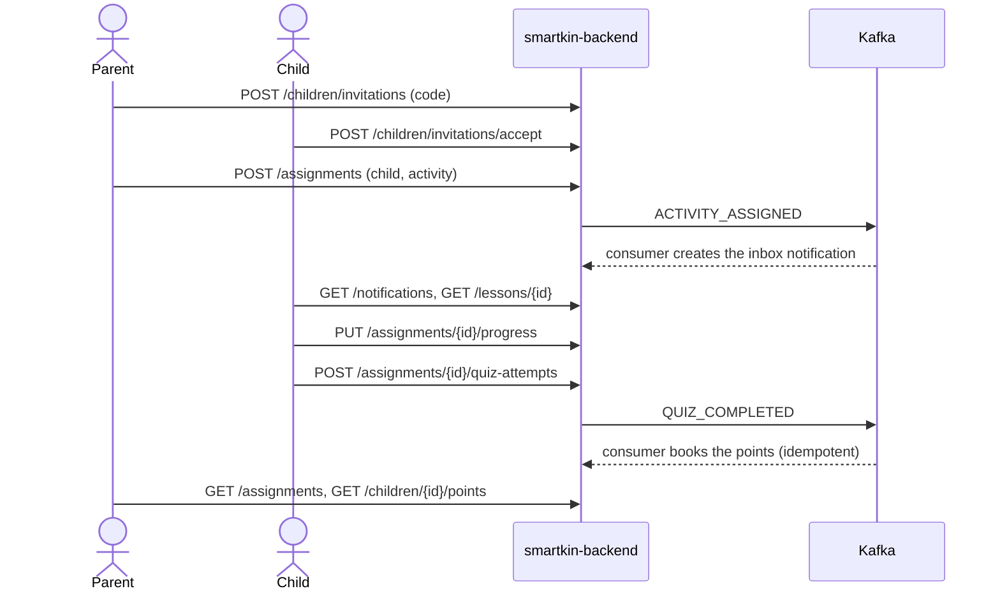

`OpenApiContractTest` checks that the file parses, every `$ref` resolves, operation ids are unique and each has a 2xx response, options carry no `correct` flag, the paged lists share `PageMeta` and the existing user endpoints are not redefined.
The frontend generates its types from this file (X-3).

## Parent and child profiles (BE-4)

`ParentApi`/`ParentController` (`/api/v1/parents`) and `ChildApi`/`ChildController` (`/api/v1/children`) implement `getMyParentProfile`, `putMyParentProfile`, `listMyChildren`, `getChild` and `updateChild` of the contract (`linkChild` was removed by S-2, see "Child invitations and accounts").
`ParentServiceImpl` and `ChildServiceImpl` hold the rules; `ParentMapper` and `ChildMapper` (MapStruct) convert the entities. `ChildRepository.findAllByParentId` is the only new query.

**Who is calling.** The caller is the `uid` claim of the session token (`JwtUtil.getUidFromToken`; the security library has already verified the token). There is no role claim: a user is a *parent* when a `smartkin.parent` row has their id and a *child* when a `smartkin.child` row does.
A token without `uid` (verification code not completed) gets 403 on every operation.

| Operation | Rule | Answers |
| --- | --- | --- |
| `PUT /parents/me` | Creates or replaces the caller's profile (all three fields are replaced, `null` clears). Not for a child. | 200, 403 |
| `GET /parents/me` | Caller's profile. | 200, 403 (child or no `uid`), 404 (no profile yet) |
| `GET /children` | Children of the calling parent. | 200, 403 (not a parent) |
| `GET /children/{id}` | The owning parent, or the child themselves. A child of another family answers 404, never 403, so its id is not revealed. | 200, 403, 404 |
| `PUT /children/{id}` | Owning parent only; replaces `gradeLevel` and `avatar` (points are never editable here). | 200, 403, 404 |

Errors are the status plus the `message-error` header with an empty body, like the existing endpoints. 
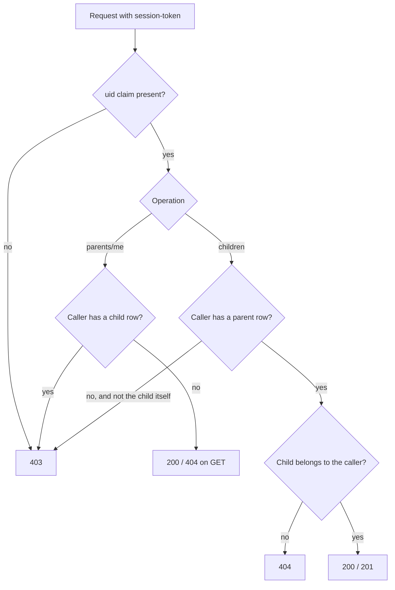

Tests: `ParentServiceImplTest`, `ChildServiceImplTest` (list, get and update, every branch, including the cross-family cases), `ParentChildControllersTest` (delegation, paths, headers and bean validation), `ParentChildMappersTest`, a repository case in `JpaMappingContainerTest`, and `ControllerContractConformanceTest`, which compares the operation id, HTTP method and path of each implemented controller with `docs/api/openapi-v1.yaml`; every later controller ticket adds its controller to that test.
The contract was amended in this ticket: errors are status plus `message-error` header, not a JSON `ErrorResponse` (see D-6).

## Child invitations and accounts (S-2)

`POST /children` linked any user id the parent typed, so a parent could capture an unrelated account (finding S-2 of `docs/SECURITY_REVIEW_MVP.md`). It is gone. `ChildLinker.create` is now the only code that inserts a `child` row and has two callers: accepting an invitation (the future child consents by presenting the code) and creating the account (the user did not exist before). `ChildEntity` implements `Persistable<UUID>` (new until loaded or persisted) because its id is assigned by backbone: without it Spring Data calls `merge`, and a second concurrent link of the same user would silently update the row and move the child to another parent. With it the call is an insert and a duplicate key becomes `DataIntegrityViolationException`, answered 409.

| Operation | Class | Rule | Answers |
| --- | --- | --- | --- |
| `POST /children/invitations` | `ChildInvitationServiceImpl.create` | Parent only. At most `MAX_PENDING_INVITATIONS` (10) pending and unexpired. Draws a code with `SecureRandom`, stores `SHA-256(code)`, expires after `INVITATION_VALID_DAYS` (7). The code is in the response only. | 201, 403, 409 |
| `GET /children/invitations` | `list` | Parent's own, newest first, no code. A `PENDING` row past its expiry is reported as `EXPIRED` (the row is not rewritten). | 200, 403 |
| `DELETE /children/invitations/{id}` | `revoke` | Parent's own only (another parent's id answers 404). Idempotent for `REVOKED`; `ACCEPTED` answers 409. | 204, 403, 404, 409 |
| `POST /children/invitations/accept` | `accept` | Any authenticated user with no `parent` and no `child` row. | 201, 404, 409 |
| `POST /children/accounts` | `ChildAccountServiceImpl.create` | Parent only; child under 18; calls `UserService.create`, then `ChildLinker.create`. | 201, 400, 403, 409, 500 |

**The code.** `InvitationCode`: 8 characters from `23456789ABCDEFGHJKMNPQRSTUVWXYZ` (31 symbols, no 0/O/1/I/L), 31^8 (about 8.5e11) combinations, displayed `ABCD-EFGH`. `normalize` upper-cases and drops spaces and hyphens; anything that is not 8 symbols of the alphabet is rejected before reaching the database. Only the hash is stored (`child_invitation.code_hash`, unique), so reading the table never yields a usable code.

**Accepting is atomic.** `accept` runs inside a `TransactionTemplate`: it looks the hash up, claims the row with one conditional statement and creates the child. Two users with one code, or one user with two codes, cannot both win.

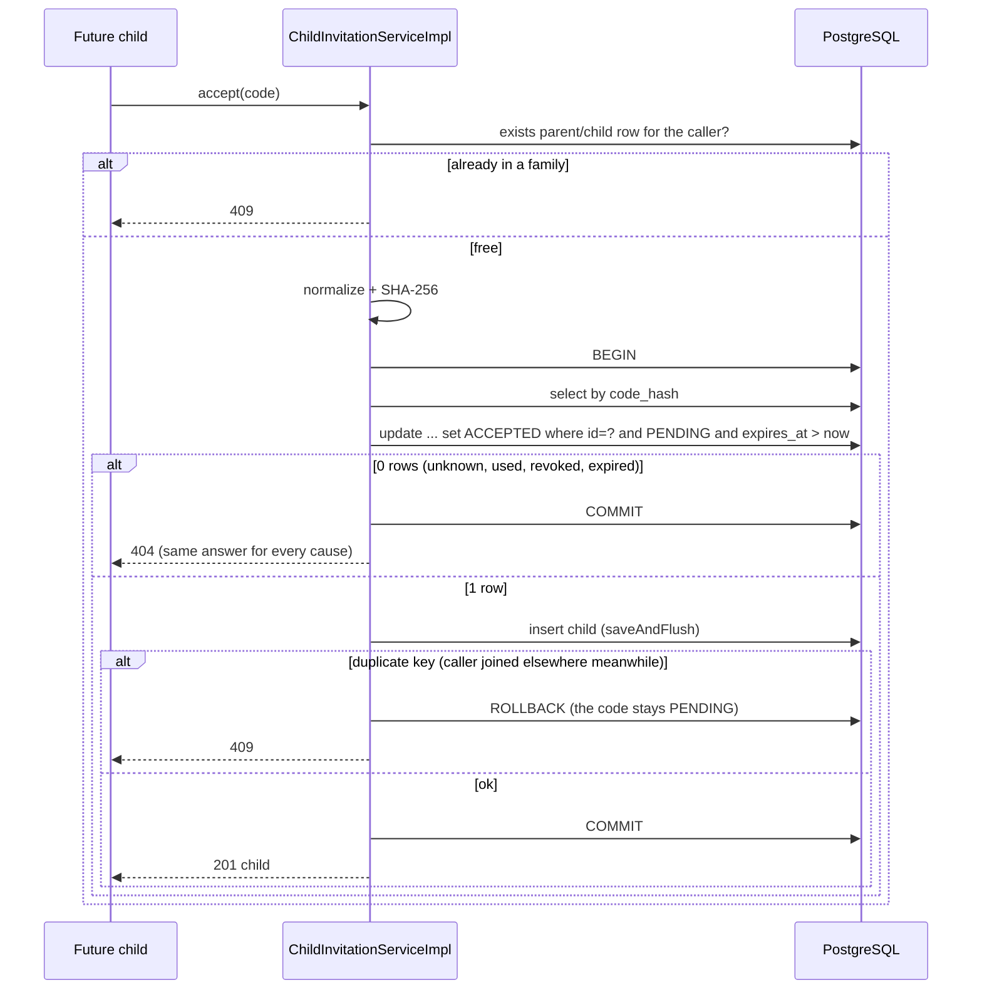

**Creating the account.** `ChildAccountServiceImpl` does not call backbone itself: it builds a `UserCreateRequest` and reuses `UserService.create`, so aliases, the backbone user, the verification e-mail and the e-mail conflict (409) behave as for every account. The parent's phone number is used because backbone requires one (`""` when the parent has none). The age rule is `birthDate > today - 18 years` and `birthDate < today`, against the injected `Clock`. If `ChildLinker.create` throws, the user just created is deleted with `UserService.deleteUserByUserAndApplication` and the answer is 500, so no account without a profile is left behind; if that deletion also fails the user remains and must be cleaned by hand (it is logged).

**Not covered here.** There is no rate limit on `accept` beyond the size of the code space and the 7-day life; a limit per caller belongs to the gateway. No e-mail is sent for an invitation (the parent shares the code); the notification of the parent when a child accepts is not implemented yet and the parent sees it in the invitation list (`ACCEPTED`).

Migration `V6__child_invitations.sql` creates `smartkin.child_invitation` (`ON DELETE CASCADE` from `parent`, check constraint on `status`, index on `(parent_id, created_at desc)`, RLS and the `smartkin_app` policy). Tests: `InvitationCodeTest`, `ChildLinkerTest`, `ChildInvitationServiceImplTest`, `ChildAccountServiceImplTest`, `ChildInvitationControllersTest` and `ChildInvitationContainerTest` (PostgreSQL: single use, 8 racing users, a user accepting two codes at once, expired and revoked codes, the limit).

## Ownership rules: `AccessPolicy` (BE-5)

Who may reach which child is decided in one place, `com.umdc.smartkin.security.access.AccessPolicy`, and every endpoint that touches a child asks it instead of re-implementing the rule (BE-7 assignments, BE-8 progress, BE-9 quiz and BE-10 points will).
There is no role claim in the token: a user is a parent when a `parent` row has their id and a child when a `child` row does.

| Method | Who is allowed | Decisions |
| --- | --- | --- |
| `viewChild(callerId, childId)` | the child themselves, or the parent the child is linked to | `SELF`, `OWNER`, `NOT_VISIBLE`, `FORBIDDEN` |
| `manageChild(callerId, childId)` | only the linked parent (a child never manages anyone, themselves included) | `OWNER`, `NOT_VISIBLE`, `FORBIDDEN` |
| `isParent(id)`, `isChild(id)` | role checks | boolean |

`ChildAccess` carries the decision and, when allowed, the loaded `ChildEntity`, so the caller does not query it twice. The services map the decision to HTTP the same way everywhere: `OWNER`/`SELF` proceed, `NOT_VISIBLE` answers **404** (the child is missing or belongs to another family, so its id is not revealed) and `FORBIDDEN` answers **403** (the caller has no right to this kind of access at all).

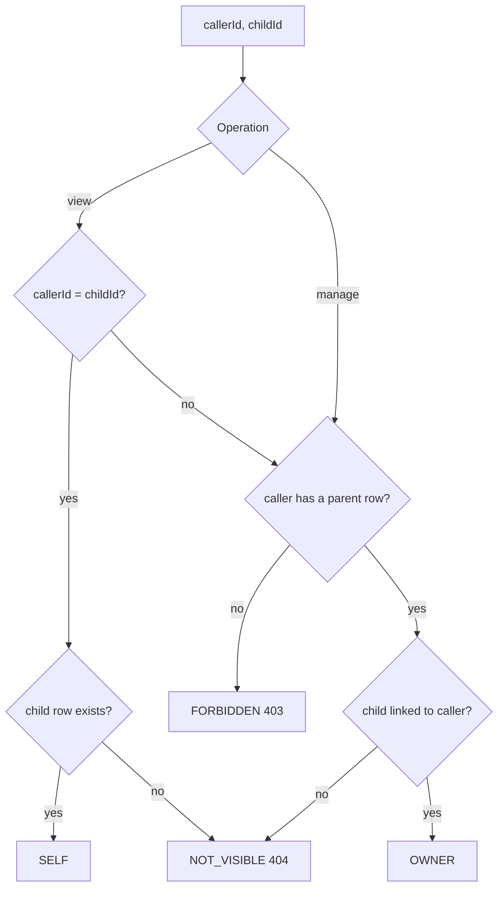

`ChildServiceImpl` and `ParentServiceImpl` now use the policy; their behavior and answers did not change (their tests pass unmodified apart from how the service is built).
Tests: `AccessPolicyTest` covers every cell of the table, and `CrossFamilyAccessContainerTest` runs the real services over PostgreSQL with two families and a user without profile: a parent lists, reads and changes only their own children, another family's child is a 404 and is left untouched, a child sees only themselves and changes nobody, a user without profile reaches nothing, and a family's child cannot be linked by another parent.

## Catalog API (BE-6)

`CatalogApi`/`CatalogController` (base `/api/v1`) implement `listTopics`, `listTopicLessons`, `getLesson`, `listActivities` and `getActivity`. They are read-only and open to any authenticated user (the security library validates the token; no ownership applies to the catalog).
`CatalogServiceImpl` reads topics and activities from PostgreSQL, the published lessons of a topic through the Redis-cached `LessonCatalogService` (so a cache outage still falls back to MongoDB), and one lesson in detail from MongoDB.

| Operation | Path | Rule |
| --- | --- | --- |
| `listTopics` | `GET /topics` | All topics ordered by name |
| `listTopicLessons` | `GET /topics/{topicId}/lessons` | Published lessons (`LessonSummary`); 404 when the topic does not exist |
| `getLesson` | `GET /lessons/{lessonId}` | Only `PUBLISHED`; draft, archived and missing lessons are 404 |
| `listActivities` | `GET /activities[?topicId=]` | Active activities ordered by title |
| `getActivity` | `GET /activities/{activityId}` | Active only; inactive and missing are 404 |

**What never leaves the server.** `CatalogMapper` converts `LessonDocument` to `LessonResponse` with its own option and question records: `correct` (options) and `feedback` (questions) do not exist in the response types, so they cannot be serialized by accident. `CatalogMapperTest` serializes a lesson to JSON and asserts neither word appears.

**Migration V4** (`V4__activity_lesson_link.sql`) adds the nullable column `smartkin.activities.lesson_id` (uuid) and a partial index. Lessons live in MongoDB, so it is a plain id and not a foreign key. Existing activities keep working with a `null` lesson; the migration is additive and the `smartkin_app` role and RLS policies need no change. `ActivityEntity.lessonId` maps it and `Activity.lessonId` / `Assignment.lessonId` expose it (BE-7 assignments will read the lesson through it).

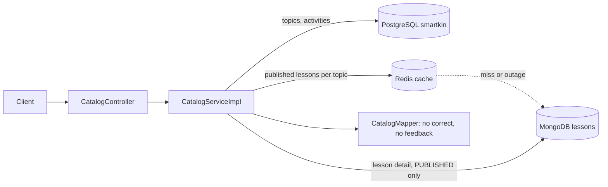

Tests: `CatalogServiceImplTest`, `CatalogControllerTest`, `CatalogMapperTest`, and four cases in `JpaMappingContainerTest` (V4 column, lesson id round trip with old activities, active filtering, topic order, on a real PostgreSQL). `ControllerContractConformanceTest` now also checks `CatalogController` against the contract.

## Assignments API (BE-7)

`AssignmentApi`/`AssignmentController` (`/api/v1/assignments`) implement `assignActivity`, `listAssignments` and `getAssignment`; `AssignmentServiceImpl` holds the rules and asks `AccessPolicy` who may reach which child. The progress operations (`getProgress`, `updateProgress`, `putParentFeedback`) belong to BE-8.

| Operation | Rule | Answers |
| --- | --- | --- |
| `POST /assignments` | Only the parent a child is linked to may assign. The activity must exist and be active, `dueDate` (optional) must be in the future, and the child must not already have that activity assigned and not completed. | 201, 400, 403 (not a parent), 404 (child of another family, or activity missing/inactive), 409 |
| `GET /assignments[?childId=&page=&size=]` | A parent sees the assignments of all their children (or one); a child sees their own. Newest first. `page` >= 0 and `size` 1 to 100. | 200, 400, 403, 404 |
| `GET /assignments/{id}` | The parent or the child of that assignment, with its progress (`null` until the child starts). Anything else is 404, so ids of other families are not revealed. | 200, 403 (no user in token), 404 |

**Event.** After a successful assignment `ACTIVITY_ASSIGNED` is published with `SmartKinEventPublisher`, **after the database commit** (`TransactionSynchronization.afterCommit`; without a transaction it runs at once). A rollback publishes nothing. If the broker fails the assignment stays and the error is logged: the child just gets no inbox notification, because there is no transactional outbox yet (D-4). The consumer (KF-2) creates that notification idempotently.

**Duplicate rule.** `AssignedActivityRepository.existsOpenAssignment` is true while no `activity_progress` row of the assignment has a `completion_time`. Once the child completes it, the same activity can be assigned again.

**Supporting code.** `ClockConfig` provides a `Clock` bean (tests fix it), `PageResponse<T>` carries the `PageMeta` fields of the contract and is reused by later paged lists, `AssignmentMapper` maps assignments and progress (`AssignmentResponse.withProgress`), and the list loads the progress of a whole page with one query (`findAllByAssignmentIdIn`) and the activity, parent and child with an entity graph, so there is no N+1.

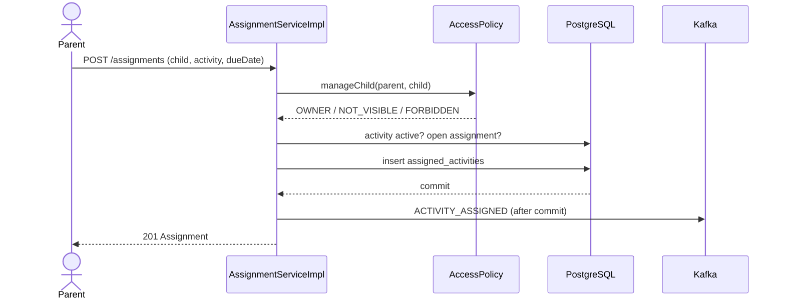

Tests: `AssignmentServiceImplTest` (every branch, publish-after-commit, no publish on rollback, a failing publisher), `AssignmentControllerTest`, `AssignmentMapperTest`, three repository cases in `JpaMappingContainerTest` (paging order, open/closed assignment, progress lookup) and two cases in `CrossFamilyAccessContainerTest` (two families assigning, listing and reading on a real PostgreSQL). `ControllerContractConformanceTest` also checks `AssignmentController`.

## Progress API (BE-8)

`ProgressApi`/`ProgressController` share the `/api/v1/assignments` base with the assignments controller and implement `getProgress`, `updateProgress` and `putParentFeedback`; `ProgressServiceImpl` holds the rules.

| Operation | Who | Rule | Answers |
| --- | --- | --- | --- |
| `GET /assignments/{id}/progress` | the parent or the child of that assignment | Before the child starts it is `0%` with no times (it is not a 404) | 200, 403 (no user in token), 404 |
| `PUT /assignments/{id}/progress` | the assigned child only | The first report creates the row and sets `startTime`; every report sets `lastAccessed`; the percentage cannot go down (400); `100` sets `completionTime` once and a later `100` leaves it unchanged | 200, 400, 403 (the parent, or no user), 404 |
| `PUT /assignments/{id}/feedback` | the assigning parent only | Stores `parentFeedback`; if the child has not started it creates an empty row (0%, no start time) | 200, 400, 403 (the child, or no user), 404 |

Anyone who cannot reach the child (another family, a sibling, a user without profile) gets 404, like for assignments. `score` is not written here: the quiz does it in BE-9.

**Concurrency.** Updates read the assignment with `AssignedActivityRepository.findForUpdateById` (`PESSIMISTIC_WRITE`, `select ... for update`). Two simultaneous first reports of the same assignment therefore run one after the other: the first creates the progress row, the second finds it. This is what prevents a violation of the unique key `activity_progress.assignment_id`, so the contract needs no 409.

**Link with assignments.** An assignment stops being "open" (and can be assigned again, see BE-7) when its progress has a `completionTime`, that is, when the child reports 100.

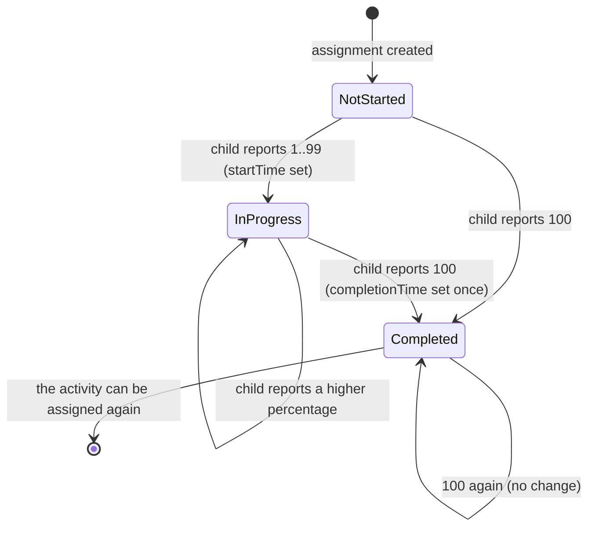

Tests: `ProgressServiceImplTest` (every branch), `ProgressControllerTest` (delegation, paths, bean validation), a lock case in `JpaMappingContainerTest`, and three cases in `CrossFamilyAccessContainerTest` (only the child reports, only the assigning parent comments, completing frees the activity to be assigned again). `ControllerContractConformanceTest` also checks `ProgressController`.

## Quiz attempts API (BE-9)

`QuizApi`/`QuizController` (base `/api/v1/assignments`) implement `submitQuizAttempt` and `listQuizAttempts`; `QuizAttemptServiceImpl` orchestrates, `QuizGrader` (`com.umdc.smartkin.quiz`) is the pure grading logic and `ProgressRecorder` writes the result into the progress. Quizzes are graded **only on the server**: the lesson sent to clients carries no `correct` flag (BE-6).

**Grading rule (agreed with the owner).** A question is correct only when the selected options are **exactly** the correct ones (no partial credit) and then earns all its `points`; a question left out earns nothing (it still appears in the stored answers, in quiz order, with an empty selection). `percentage = score * 100 / maxScore`, rounded down (0 for a quiz worth no points); the quiz is **passed** when `percentage >= passingPercentage` (inclusive). A question with no correct option in the lesson never earns points. Answers that name an unknown question or option, or answer a question twice, are rejected with **400** and nothing is written.

| Step | Detail |
| --- | --- |
| Who | Only the assigned child. The parent gets 403, anyone outside the family 404 (as for progress). |
| Which quiz | The `PUBLISHED` lesson of the assignment's activity (`activities.lesson_id`). No lesson, an unpublished one or one without questions answers 404 (`QUIZ_NOT_AVAILABLE_MESSAGE`). |
| Limit | `maxAttempts` counts the attempts **of this assignment** (`countByAssignmentId`); the next one answers 409. `attemptNumber` is the child's running count for that lesson (`countByChildIdAndLessonId` + 1), because the unique index of `quiz_attempts` is `childId + lessonId + attemptNumber`. |
| Result | The attempt is stored with the lesson `version` it was graded against. `startedAt` and every `answeredAt` equal `completedAt` (the client does not send times). |
| Progress | `ProgressRecorder` keeps the **best** percentage as `score`; **passing completes the assignment** (100% and `completionTime`, once), so the parent can assign the activity again. A failed attempt never lowers a completion already reached. |
| Event | `QUIZ_COMPLETED` goes out after the commit through `DomainEventDispatcher`; the KF-2 consumer books `score` as points only when `passed`. |

**Consistency between PostgreSQL and MongoDB.** The assignment is read with `findForUpdateById` (write lock), so attempts of one assignment are graded one at a time and the limit cannot be passed by concurrent submissions. The attempt is inserted first: a duplicate key answers 409 before anything else was written. Then the progress is written; if that fails the attempt is deleted and the error propagates, so the transaction rolls back and no event is sent. The only gap left is a failure of the commit itself after the insert, which would leave an attempt without progress (there is no distributed transaction).

`feedback` (the explanation each question has in the lesson) is returned with the attempt, after the child answered, for the child and the parent; it is looked up in the current lesson and is `null` if the lesson or question no longer has one. `DomainEventDispatcher` was extracted from BE-7 so both services share the publish-after-commit behaviour.

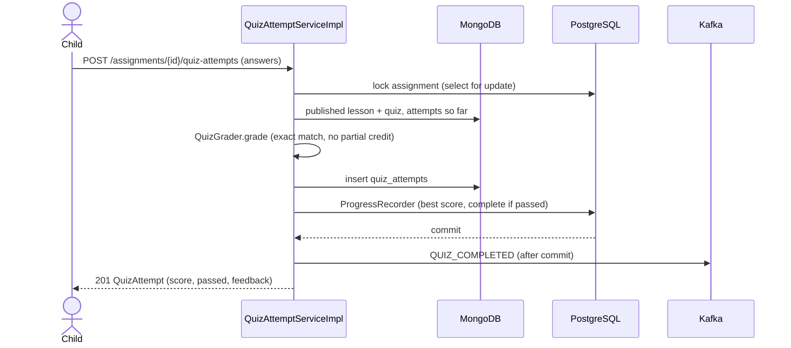

Tests: `QuizGraderTest` (exact-set rule, unanswered questions, rounding, pass mark, invalid answers), `QuizAttemptServiceImplTest` (every branch, including the duplicate key and the compensation), `ProgressRecorderTest`, `QuizAttemptMapperTest`, `QuizControllerTest`, `DomainEventDispatcherTest`, a MongoDB case for the new repository methods and two cases in `CrossFamilyAccessContainerTest` (only the child takes the quiz; failing keeps the assignment open, passing completes it).

## Points and achievements API (BE-10)

`RewardsApi`/`RewardsController` (base `/api/v1/children`, shared with `ChildController`) implement `getChildPoints` and `listChildAchievements`; `RewardsServiceImpl` reads through the existing repositories and `RewardsMapper`. Both are read-only: points and achievements are **written only by the event consumers** (KF-2) and the achievement rules (BE-11), never by these endpoints.

| Operation | Path | Rule |
| --- | --- | --- |
| `getChildPoints` | `GET /children/{childId}/points?page=&size=` | `{childId, totalPoints, transactions}` where `transactions` is a `PageResponse` (page from 0, size 1 to 100, default 20) of the child's point movements, newest first (`transactionDate` desc). Bad page or size is 400. |
| `listChildAchievements` | `GET /children/{childId}/achievements` | The achievements the child earned, newest first, each with the data of the achievement (`name`, `description`, `icon`, `pointsValue`) loaded in the same query (`@EntityGraph`). |

**Access.** `AccessPolicy.viewChild`: the child themselves or the parent they are linked to. A child of another family answers **404**; a sibling or a user without profile answers **403**; a token without `uid` answers 403.

**Balance.** `totalPoints` is `child.total_points`, which the KF-2 consumers raise in the same transaction in which they insert the `points` row, so it equals the sum of the `EARN` movements minus the `SPEND` ones as long as every movement goes through them. Nothing here recomputes it.

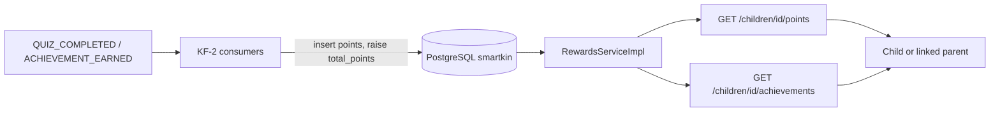

Tests: `RewardsServiceImplTest` (every branch, sort order and paging), `RewardsControllerTest`, `RewardsMapperTest`, two repository cases in `JpaMappingContainerTest` (paging and ordering without mixing children, achievements with their achievement loaded) and one in `CrossFamilyAccessContainerTest`. `ControllerContractConformanceTest` also checks `RewardsController`.

## Achievement rules (BE-11)

An achievement is earned by a **rule** stored as JSON in `achievements.requirements`, for example `{"type":"QUIZZES_PASSED","threshold":3}`. `AchievementRule.parse` reads it; text that is not a valid rule (free text, unknown `type`, missing or non-positive `threshold`) is logged and that achievement is simply never awarded, without affecting the others.

| `type` | What is counted | Source |
| --- | --- | --- |
| `QUIZZES_PASSED` | **distinct lessons** whose quiz the child passed (passing twice the same lesson counts once) | MongoDB `quiz_attempts` (`findByChildIdAndPassedTrue`) |
| `ACTIVITIES_COMPLETED` | **distinct activities** with a completed assignment (`completion_time` set); repeating an activity does not count again, an open assignment does not count | `ActivityProgressRepository.countCompletedActivities` |
| `POINTS_REACHED` | the child's balance | `child.total_points` |

The rule is met when the count is `>= threshold`.

**When it is evaluated.** `AchievementTrigger` starts an evaluation, and it never lets a failure reach the caller (the evaluation is idempotent and recounts from scratch, so the next trigger catches up):
1. in `SmartKinEventListener`, after `QUIZ_COMPLETED` of a **passed** quiz and after `ACHIEVEMENT_EARNED`, once `EventEffectsService` has committed the points. Evaluating there, and not in the request, is what makes `POINTS_REACHED` see the points the quiz just earned, and the points of an achievement can complete another rule (a cascade that ends because each achievement is awarded once);
2. in `ProgressServiceImpl`, after the commit of the report that first sets `completionTime` (a child who reports 100 by hand); passing a quiz completes the assignment too, but that case is covered by the first trigger.

**Awarding.** `AchievementEvaluator.evaluate` runs in its **own transaction** (`REQUIRES_NEW`): it sees what the caller already committed and a failure cannot roll the caller back. For each achievement not yet earned whose rule is met it runs `ChildAchievementRepository.insertIfAbsent`, a native `insert ... on conflict do nothing`, and only when a row was inserted does it publish `ACHIEVEMENT_EARNED` (after the commit, `DomainEventDispatcher`). The unique index `uq_child_achievements_child_achievement` (migration V5) makes "once per child" true even if two evaluations race. The existing KF-2 consumer books `pointsValue` and notifies the child.

**Migration V5** (`V5__achievement_rules.sql`) creates that unique index and seeds **three placeholder achievements** with fixed ids (`Primer quiz aprobado`: 1 quiz, 10 points; `Explorador`: 3 activities, 25 points; `Cien puntos`: 100 points, 20 points). They exist so the feature works out of the box; the product team should edit the text, points and thresholds, or add rows, with plain SQL. The migration fails only if `child_achievements` already holds the same child and achievement twice, which cannot happen because nothing wrote that table before this ticket.

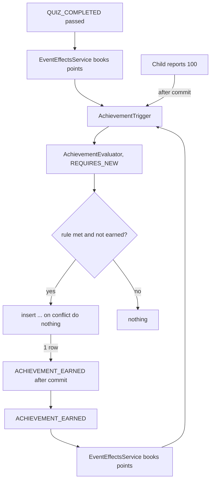

Tests: `AchievementRuleTest`, `AchievementTriggerTest`, `AchievementRulesContainerTest` (real PostgreSQL, no test transaction because of `REQUIRES_NEW`: V5 seed, once-only award and event, points threshold, distinct activities and lessons, open assignments, invalid rules, unknown child, the unique index), plus the new cases in `SmartKinEventListenerTest`, `ProgressServiceImplTest` and `DomainEventDispatcherTest`.
Known limits: a lost `ACHIEVEMENT_EARNED` (broker down, no outbox) leaves the achievement earned without its points and notification; the achievement itself is never lost.

## Notifications API (BE-12)

`NotificationApi`/`NotificationController` (`/api/v1/notifications`) implement `listNotifications`, `getUnreadNotificationCount`, `markAllNotificationsRead` and `markNotificationRead`; `NotificationServiceImpl` holds the rules. The notifications themselves are **created by the KF-2 consumers** (new assignment, new achievement); these endpoints only read and mark them.

| Operation | Path | Rule |
| --- | --- | --- |
| `listNotifications` | `GET /notifications?unread=&page=&size=` | The caller's inbox, newest first (`createdAt` desc), as a `PageResponse`; `unread=true` keeps only the unread ones. Page from 0, size 1 to 100, else 400. |
| `getUnreadNotificationCount` | `GET /notifications/unread-count` | `{count}` of the caller's unread notifications (the header badge of the frontend). |
| `markNotificationRead` | `POST /notifications/{id}/read` | 204. Idempotent: an already read notification keeps its first `readAt`. Someone else's or a missing notification is 404. |
| `markAllNotificationsRead` | `POST /notifications/read-all` | 204. One `update` statement (`markAllRead`) that touches only the caller's unread notifications; it returns how many changed. |

**Ownership.** The caller is the `uid` of the session token and it is the `user_id` of the notifications, so there is no role logic: every user, parent or child, has their own inbox and never reaches anyone else's. A token without `uid` is 403. Reading another user's notification id answers 404 (`findByIdAndUserId`), like a missing one.

**Wire format.** `NotificationResponse` serializes the flag as `read` (the contract name) from the entity's `isRead`; `type` is one of `ASSIGNMENT`, `REMINDER`, `ACHIEVEMENT`, `REWARD`, `GOAL`, `SYSTEM`.

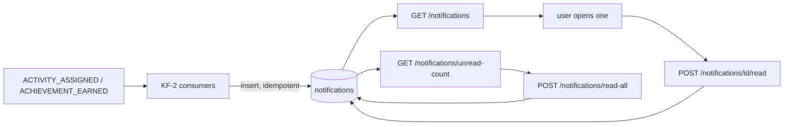

Tests: `NotificationServiceImplTest` (every branch), `NotificationControllerTest` (routing of `/unread-count`, `/read-all` and `/{id}/read`), `NotificationMapperTest`, three repository cases in `JpaMappingContainerTest` (paging and the unread filter, ownership, `markAllRead`) and one in `CrossFamilyAccessContainerTest` (each user has their own inbox). `ControllerContractConformanceTest` also checks `NotificationController`; with this ticket **every operation of the contract is implemented and checked**.

## End-to-end flow test (BE-13)

`EndToEndFlowContainerTest` (`com.umdc.smartkin.flow`) runs the whole MVP slice on **real infrastructure**: PostgreSQL 17 with Flyway V1 to V5, MongoDB 7 and Kafka 4.0, all in Testcontainers (Docker must be running). The services, the Kafka publisher, the consumers (`SmartKinEventListener`, `EventEffectsService`) and the achievement evaluator are the production beans; the test calls the same service methods the controllers call, with real session-token payloads.

It walks one family through the product:
1. a parent saves their profile and links a child; another family's parent exists too;
2. the parent finds the published lesson in the catalog;
3. the parent assigns the activity: `ACTIVITY_ASSIGNED` goes through Kafka and the child gets an inbox notification, which they mark as read;
4. the child reports 40%; the parent reads it;
5. a **wrong** quiz attempt is graded on the server: no completion, score 0;
6. a **passing** attempt completes the assignment, and asynchronously through Kafka the quiz points arrive (`QUIZ_COMPLETED`), the achievement "Primer quiz aprobado" is awarded, its points are booked and its notification created (`ACHIEVEMENT_EARNED`), for a final balance of 20 points, two point movements and one unread notification;
7. the parent can assign the same activity again, but not twice; the other family gets 404 on points, progress and attempts;
8. no `dead_lettered` or `dead_letter_failed` counter moved (BE-14), so no event fell into the error topic.

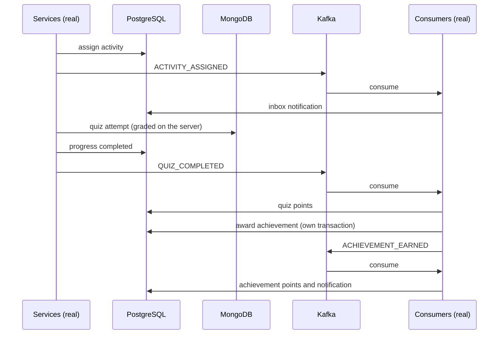

**What it deliberately does not start.** The web layer (the controllers have their own MockMvc tests and the conformance test), the PRX security library, Vault, the TLS bundle and Redis (RD-1 and RD-2 have their own container tests). Booting the complete application needs the QA environment of BE-2: about 40 variables and keystores that are not in the repository, so it cannot be hermetic in CI. This test closes the gap that mattered most: before it, no test had ever run the services, the real Kafka consumers and the databases together.

It waits for the asynchronous steps with a polling helper (up to 60 s each, 200 ms step). In three consecutive runs it took 9 s.
## Error topic monitoring (BE-14)

`ErrorTopicMonitor` wraps the consumer's error handling (`KafkaConsumerConfig.smartKinErrorHandler`) so failures are visible. It does not change what happens to a record: retries, back-off and the move to `smartkin.events.error.v1` are exactly those of KF-3.

| Signal | Meaning |
| --- | --- |
| counter `smartkin.events.delivery_failed` (tag `topic`) | a delivery of a record failed and it is being retried (one increment per failed attempt; a malformed record fails once) |
| counter `smartkin.events.dead_lettered` (tags `topic`, `exception`) | a record gave up and was published to the error topic; `exception` is the simple class name of the cause |
| counter `smartkin.events.dead_letter_failed` (tag `topic`) | publishing to the error topic itself failed (typically: the topic does not exist). The error propagates, the offset is not committed and the record is retried, so nothing is lost |
| log `ERROR DEAD_LETTERED topic-partition@offset key=... cause=...` | the same event for log based alerting; `DEAD_LETTER_FAILED ...` for the last row |

**What to alert on** (suggested): any increase of `smartkin.events.dead_lettered` over 5 minutes (a record needs a human), and **any** `smartkin.events.dead_letter_failed` (events are stuck until the error topic exists). A sustained rise of `delivery_failed` without `dead_lettered` means a dependency (database, MongoDB) is flapping.

**Scraping.** The counters live in the application's `MeterRegistry`. The service exposes only `health` (`management.endpoints.web.exposure.include`), so nothing is scrapeable yet and no registry such as Prometheus is on the classpath: choosing one and securing its endpoint depends on the platform, so this ticket does not do it. Until then the log marker is the alertable signal.

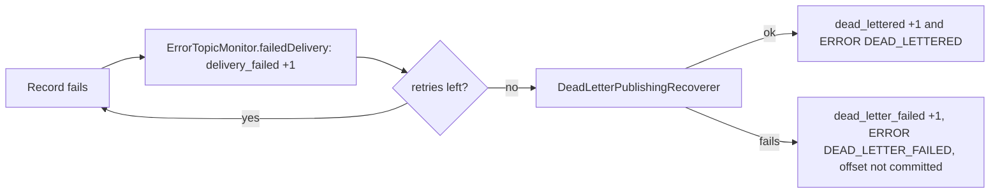

Tests: `ErrorTopicMonitorTest` (counting, tags, failure of the error topic) and the extended `ConsumerRetryContainerTest`, which on a real Kafka asserts the counters for one malformed record and one record that fails its retries.

## QA verification kit (BE-2, BE-3, X-1, X-4, S-1)

Some tickets can only be closed in the QA environment. The repository ships what can be prepared so that closing them is mechanical:

| File | What it is |
| --- | --- |
| `docs/QA_RUNBOOK_MVP.md` | The ordered procedure and a "done when" checklist |
| `scripts/qa-smoke.sh` | Automated S-1 check, invitation flow and vertical slice against a running service |
| `docs/ops/smartkin-events.rules.yml` | Prometheus rules for the error topic (`AlertRulesTest` keeps them aligned with the code) |
| `docs/ACHIEVEMENTS_CATALOG.md`, `docs/db/achievements_catalog_proposal.sql` | The proposed achievement catalog (`AchievementCatalogProposalTest`) |

**What the smoke test proves about S-1.** The controllers read `uid` with `JwtUtil` without verifying the signature, which is safe only if the PRX library rejects bad tokens first. The script sends, to `GET /parents/me`, `GET /children`, `GET /notifications` and `POST /assignments`: a token with a wrong signature, a token with `alg: none` and no signature, the payload of one user with the signature of another, and optionally an expired and a revoked token. **All must answer 401.** Any 2xx or 403 means the unverified `uid` is trusted: replace `JwtUtil.getUidFromToken` by the validated `Claims`.

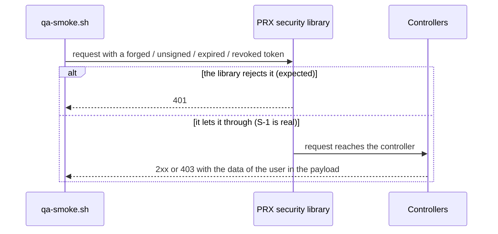

**Alerts.** `ErrorTopicMonitor` registers `smartkin.events.delivery_failed`, `smartkin.events.dead_lettered` and `smartkin.events.dead_letter_failed`; Prometheus sees them as `smartkin_events_*_total`. `AlertRulesTest` parses the rules, requires a severity and a description on each, and compares the metrics they query with the names in `ErrorTopicMonitor`, so renaming a counter without updating the alert fails the build. The service exposes only `health` today; a Prometheus registry and a protected scrape path are a platform decision (see the runbook).

**Achievements.** The catalog proposal is a SQL script, not a migration, because the names, points and thresholds belong to the product team. `AchievementCatalogProposalTest` parses every `requirements` with `AchievementRule.parse`, so a typo in a rule fails the build instead of silently never awarding.

## Security review of the MVP (X-5)

`docs/SECURITY_REVIEW_MVP.md` records the review of both repositories: what was verified (ownership and cross-family isolation, answers never leaving the server, Row Level Security, bounded inputs, token revocation), what was **fixed** (the BFF wrote tokens, passwords and Vault values to its logs; fixed in smartkin-frontend, see its guide) and what stays **open**:

- **S-1, verify in QA:** the controllers take the caller from the `uid` of the token payload without checking its signature (`JwtUtil.getUidFromToken`); that is safe only if the PRX security library rejects forged, unsigned, expired and revoked tokens before the controller runs, which no test here starts. The document lists the exact calls to make in X-1/X-4 and what to do if any is not a 401.
- **S-2, product decision:** `POST /children` links any existing user id without that user's consent.
- Rotate the Vault token in the git history (FE-2) and re-check the frontend's dependency alerts after the upgrade chain is merged.

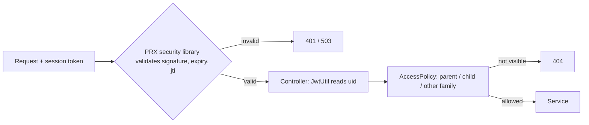

The first box is the assumption of S-1: everything after it is covered by tests.

## Spring Boot 4 migration notes

- `@EntityScan` lives in `org.springframework.boot.persistence.autoconfigure`.
- Jackson 3 uses `tools.jackson.*` (`ObjectMapper`, `JacksonException`, unchecked). Jackson annotations stay in `com.fasterxml.jackson.annotation`.
- javac no longer finds annotation processors on the classpath: `maven-compiler-plugin` lists `mapstruct-processor` and
  `spring-boot-configuration-processor` in `annotationProcessorPaths`.
- Surefire passes JaCoCo's `${argLine}` plus the Mockito agent; ASM 9.10.1 is required to read Java 25 bytecode.

## Feign client URLs

`@FeignClient(url = "${prx.clients.backbone.url}")` and `${prx.clients.mercury.url}` are resolved from `bootstrap.yml`, where
`BACKBONE_URL` and `MERCURY_URL` override the QA defaults. `FeignClientUrlConfigTest` checks the placeholders, the defaults and the override.

## Library property names

The com.umdc libraries bind `umdc.*` properties, not the old `prx.*` ones: `umdc.security.auth.clients` (outbound clients backbone and mercury), `umdc.security.jwt.{secret,expirationMs}`, `umdc.api.endpoint`, `umdc.backbone.base-url`, `umdc.management.clientRoles`, `umdc.logging.trace.enabled`. `LibraryPropertiesBindingTest` binds them from `bootstrap.yml`. The application's own settings keep the `prx.*` prefix (`prx.clients.*`, `prx.security.revocation.*`, `prx.cache.*`, `prx.kafka.*`, `prx.smartkin.*`).

## Known gaps

- The service starts only with the full environment (Vault, Config Server, SSL bundle, OAuth clients); startup with a complete
  environment was not verified in this task.
- The Docker image was not built in this task.
- The error topic must exist before the first failure (the application does not create topics). The application now counts and logs what goes to it (see *Error topic monitoring*), but the **alert rule itself** is the platform team's: it needs a metrics scraper or a log monitor that this repository does not configure.
- The enum labels (D-2) and the baseline DDL are derived from the entities and need confirmation against any existing `smartkin` schema in `umdevc`.
- Flyway and the Supabase connection were exercised only against a Testcontainers PostgreSQL, not against Supabase.
