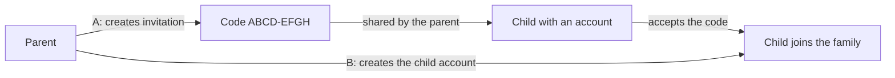

# SmartKin Backend: User Guide

This guide is for people who consume or operate the SmartKin API. It describes what the service does today.

## What the API offers

Base path: `/api/v1`, served over HTTPS (TLS 1.3 only). Interactive documentation is available through the
OpenAPI UI (springdoc) when the service is running.

| Operation | Method and path | Notes |
| --- | --- | --- |
| Create a user | `POST /api/v1/users` | Returns 201; 409 when alias or email already exists |
| Get a user | `GET /api/v1/users/{id}` | |
| Update a user | `PUT /api/v1/users/{userId}` | |
| Delete a user | `DELETE /api/v1/users/{userId}` | |
| Generate a session token | `POST /api/v1/auth/session-token` | Body with `alias` and `password` |
| Confirm a verification code | registration controller | Delegated to mercury |

Authenticated calls carry the session token in the header defined by `SESSION_TOKEN_KEY` (`session-token`).

## What changed for operators in this release

- The service now runs on **Java 25** and **Spring Boot 4.1.1**. Hosts and containers need a Java 25 runtime; the Docker image
  `amazoncorretto:25.0.4-alpine3.24` already includes it.
- The API contract (paths, request and response bodies) did not change.
- Configuration is unchanged, except for two optional variables: `BACKBONE_URL` and `MERCURY_URL` set the base URL of each service
  (default `https://prx-qa.backbone.tst/backbone` and `https://prx-qa.backbone.tst/mercury`). Set them per environment, for example in the
  Config Server or Vault.

- Data: SmartKin now stores its data in the `smartkin` schema of the existing Supabase project, created by database migrations at startup. Configure the
  connection with `SMARTKIN_DB_URI`, `SMARTKIN_DB_USERNAME` and `SMARTKIN_DB_PASSWORD` (see the technical guide for the other variables). User accounts stay in backbone;
  the API does not change.
- MongoDB: lessons, quiz attempts and interaction events will be stored in MongoDB. Set `SMARTKIN_MONGO_HOST`, `SMARTKIN_MONGO_USERNAME` and `SMARTKIN_MONGO_PASSWORD`
  (and optionally `SMARTKIN_MONGO_DATABASE`). Raw interaction events expire after 90 days by default (`SMARTKIN_INTERACTION_EVENTS_RETENTION`). No endpoint changes yet.
- Sessions: a token that backbone has revoked (for example after logout) is now rejected by SmartKin within about 30 seconds. Set `REVOCATION_REDIS_URL` to the Redis that
  backbone uses; the service will not start without it unless `REVOCATION_ENABLED=false`. If that Redis is down, authenticated calls answer **503** until it is back.
- Cache: set `CACHE_REDIS_URL` to speed up the lesson catalog; leave it empty to read straight from MongoDB. A cache outage never breaks the catalog.
- Database access: SmartKin's tables are closed to direct access (Row Level Security). Run the application with the `smartkin_app` database role (enable it with a password, see the technical guide)
  and run migrations with the schema owner via `SMARTKIN_FLYWAY_USERNAME` and `SMARTKIN_FLYWAY_PASSWORD`.
- Events: SmartKin now defines the Kafka topics `smartkin.activity.assigned.v1`, `smartkin.quiz.completed.v1` and `smartkin.achievement.earned.v1` for other services to consume. Ask the platform team to create them
  before the first release that publishes to them; nothing publishes yet.
- Events: SmartKin now also reads its three event topics. Passing a quiz and earning an achievement add points to the child, and new assignments and achievements appear in the child's
  inbox. Records that cannot be processed are retried and then sent to the error topic `smartkin.events.error.v1`, which the platform team must create and monitor (see the technical guide).
  Apply migration V3 (it runs at startup) before the first event arrives.
- Delivery: every pull request now runs the build and tests on Java 25 in GitHub Actions.
- Quality: the build now runs 150 automated tests and fails below 85% coverage. This has no effect on API consumers.
- Fix: confirming a verification code no longer fails with an internal error when mercury rejects it without a `message` header; the
  response keeps mercury's status and an empty `message` header.

## Parents and children (new)

A parent can now keep a profile and add children to the family (see the next section). All calls carry the session token.

| Operation | Method and path | Notes |
| --- | --- | --- |
| Save my parent profile | `PUT /api/v1/parents/me` | Optional phone (max 20), address, picture. Creates the profile the first time |
| Read my parent profile | `GET /api/v1/parents/me` | 404 until it is saved |
| List my children | `GET /api/v1/children` | Only the caller's children |
| Read a child | `GET /api/v1/children/{childId}` | The parent, or the child themselves. Another family's child answers 404 |
| Edit a child | `PUT /api/v1/children/{childId}` | Parent only; grade level and avatar |

Privacy between families is enforced on every call: a parent only ever sees and edits their own children, a child only sees themselves and cannot edit anything, and asking for a child of another family answers **404** exactly as if it did not exist. A user with neither a parent nor a child profile gets 403.

Errors return the HTTP status and the reason in the `message-error` header. Nothing existing changes. A user whose verification code is not completed gets 403 here.

## Adding a child to the family (new)

A child joins a family in one of two ways. In both, nobody is added without an explicit action: a parent can no longer type any user id and link it.

**A. The child already has a SmartKin account: invitation.**

1. The parent calls `POST /api/v1/children/invitations` (optional `gradeLevel` and `avatar`). The answer carries a code such as `K7M2-QX9P`. **It is shown only once**; write it down or send it to the child.
2. The child signs in with their own account and calls `POST /api/v1/children/invitations/accept` with `{"code": "K7M2-QX9P"}` (upper or lower case, with or without the hyphen). They become the parent's child, with the grade and avatar the parent chose.
3. A user belongs to one family only: if two invitations are accepted at the same moment, one is accepted and the other answers 409 and stays usable.
4. The parent can follow the invitations with `GET /api/v1/children/invitations` (`PENDING`, `ACCEPTED`, `REVOKED` or `EXPIRED`) and cancel one that was not used with `DELETE /api/v1/children/invitations/{invitationId}`.

Rules: a code works **once** and for **7 days**; a parent can have at most **10 pending** invitations (409 after that); a user who is already a parent or a child cannot accept (409); a wrong, used, revoked or expired code always answers the same **404**.

**B. The child has no account: the parent creates it.**

The parent calls `POST /api/v1/children/accounts` with the child's first name, last name, birth date (`yyyy-MM-dd`, the child must be **under 18**), an e-mail address that no other SmartKin user uses, a password of 8 to 72 characters and, optionally, grade and avatar. The answer gives the child profile and the **alias** (user name) the child signs in with. A verification code is sent to the e-mail, exactly as for any new account. If the e-mail is already used the answer is 409 and nothing is created.

## Assignments (new)

A parent gives an activity to one of their children, and both can follow it. All calls carry the session token.

| Operation | Method and path | Notes |
| --- | --- | --- |
| Assign an activity | `POST /api/v1/assignments` | Body `childId`, `activityId`, optional `dueDate` (must be in the future). Parent only, and only for their own children. 409 if the child already has that activity assigned and not completed |
| List assignments | `GET /api/v1/assignments` | A parent sees all their children's (add `?childId=` for one); a child sees their own. Newest first, paged with `page` (from 0) and `size` (1 to 100, default 20) |
| Read an assignment | `GET /api/v1/assignments/{assignmentId}` | Includes the child's progress once they start. An assignment of another family answers 404 |

Assigning an activity also sends the child a notification in their inbox. If the notification service is down at that moment the assignment is still created and only the notification is missing.

## Monitoring the error topic (new, for operators)

Events that fail all their retries go to `smartkin.events.error.v1` (see the events section). The service now records it: metrics `smartkin.events.dead_lettered`, `smartkin.events.delivery_failed` and `smartkin.events.dead_letter_failed`, and an `ERROR` log line starting with `DEAD_LETTERED` (or `DEAD_LETTER_FAILED` when the error topic itself cannot be written, for example because it was never created). Alert on any `DEAD_LETTERED` or `DEAD_LETTER_FAILED` line. The metrics are not scrapeable yet because only `health` is exposed; there is no change for API consumers.

## Notifications (new)

Every user has an inbox. The service puts notifications in it by itself (a new activity for the child, a new achievement) and these calls read and mark them. All carry the session token.

| Operation | Method and path | Notes |
| --- | --- | --- |
| Read the inbox | `GET /api/v1/notifications` | Newest first, paged with `page` (from 0) and `size` (1 to 100, default 20). Add `?unread=true` for the unread ones only. Each notification says its type, title, text, whether it was read and when |
| Count the unread | `GET /api/v1/notifications/unread-count` | `{"count": 3}`, meant for the badge in the header |
| Mark one as read | `POST /api/v1/notifications/{notificationId}/read` | 204. Doing it twice is harmless. A notification of someone else answers 404 |
| Mark all as read | `POST /api/v1/notifications/read-all` | 204. Only your own notifications change |

The notification about a new activity or achievement appears a few seconds after it happens, because it is created in the background.

## How achievements are earned (new)

Achievements are given automatically, once per child, when one of these conditions is met (the number is set per achievement):
- **Quizzes passed:** the child passed the quiz of N different lessons.
- **Activities completed:** the child completed N different activities.
- **Points reached:** the child's balance reached N points.

When a child earns one they receive its points, a notification, and it shows up in `GET /api/v1/children/{childId}/achievements`. It can take a few seconds after passing a quiz, because the points and the achievements are processed in the background. The first release comes with three example achievements (first quiz passed, 3 activities completed, 100 points); the team in charge of content can change them or add more directly in the database.

**Operators:** this release adds database migration V5 (a unique index so a child cannot earn the same achievement twice, and the three starter achievements). It runs at startup with the Flyway account and does not change existing data.

## Points and achievements (new)

| Operation | Method and path | Notes |
| --- | --- | --- |
| Points of a child | `GET /api/v1/children/{childId}/points` | The balance and the child's point movements, newest first, paged with `page` (from 0) and `size` (1 to 100, default 20). Each movement says whether it was earned or spent and why |
| Achievements of a child | `GET /api/v1/children/{childId}/achievements` | The achievements the child has earned, newest first |

The child can see their own and the parent can see those of their children; a child of another family answers 404 and a sibling 403. Points arrive by themselves when a quiz is passed or an achievement is earned; they cannot be edited through these calls.

## Quiz (new)

| Operation | Method and path | Who | Notes |
| --- | --- | --- | --- |
| Take the quiz | `POST /api/v1/assignments/{assignmentId}/quiz-attempts` | the assigned child | Body `answers`: for each question `questionId` and the `selectedOptionIds` picked. The server grades it and answers 201 with the score |
| See the attempts | `GET /api/v1/assignments/{assignmentId}/quiz-attempts` | the parent or the child | Oldest first, with how each question was graded and its explanation |

How it is graded: a question counts only if the child picks **exactly** the right options (there is no partial credit) and then earns all of its points; questions left unanswered earn nothing. The percentage is the points earned over the points of the quiz, rounded down, and the quiz is passed when it reaches the pass mark of the lesson (for example 70%).
Passing the quiz **completes the activity** and gives the child the points of the quiz; failing keeps the activity open so the child can try again, up to the number of attempts the lesson allows (the next attempt answers 409). The best score is kept in the progress.
Errors: 400 if an answer names a question or option that is not in the quiz, 403 if a parent tries to answer, 404 if the activity has no published quiz or the assignment belongs to another family.

## Progress and feedback (new)

| Operation | Method and path | Who | Notes |
| --- | --- | --- | --- |
| Read the progress | `GET /api/v1/assignments/{assignmentId}/progress` | the parent or the child | 0% with no dates until the child starts |
| Report progress | `PUT /api/v1/assignments/{assignmentId}/progress` | the assigned child | Body `completionPercentage` 0 to 100. It cannot go down; 100 marks the activity as completed and lets the parent assign it again |
| Leave feedback | `PUT /api/v1/assignments/{assignmentId}/feedback` | the parent who assigned it | Body `parentFeedback`, not empty. The child sees it in the progress |

A parent cannot report progress for the child, and a child cannot write feedback (both answer 403). Anyone outside the family gets 404.

## Catalog (new)

Any signed-in user can browse what a child can learn. All calls are `GET` and carry the session token.

| Operation | Path | Notes |
| --- | --- | --- |
| Topics | `/api/v1/topics` | Ordered by name |
| Lessons of a topic | `/api/v1/topics/{topicId}/lessons` | Published lessons only; 404 if the topic does not exist |
| A lesson | `/api/v1/lessons/{lessonId}` | Scenes and quiz, ready to play. The quiz never says which option is correct (the server grades the answers); drafts and archived lessons answer 404 |
| Activities | `/api/v1/activities` and `/api/v1/activities?topicId=...` | Active activities a parent can assign; each says which lesson it plays (`lessonId`, empty for older activities) |
| An activity | `/api/v1/activities/{activityId}` | 404 when it does not exist or is inactive |

**Operators:** this release adds database migration V4 (a nullable `lesson_id` column on `activities`). It runs at startup with the Flyway account (`SMARTKIN_FLYWAY_USERNAME`) and does not change or remove any data.

## API contract for the MVP

The operations the MVP will offer are described in `docs/api/openapi-v1.yaml`: invite a child (or create the child's account), browse topics, lessons and activities, assign an activity, report progress, submit a quiz,
see points and achievements, and read the notification inbox. This release only publishes the description; **none of these endpoints exists yet**, and the current ones (users, registration, session token) work as before.
Each endpoint will be available as its ticket is delivered. The quiz answers are graded by the server and the lessons never tell the client which option is correct.

## Security review (for operators)

The security review of the MVP is in `docs/SECURITY_REVIEW_MVP.md`. Before opening the service to real families: verify in QA that the API refuses forged, unsigned, expired and revoked tokens (the exact checks are listed there), and rotate the Vault token that is in the history of smartkin-frontend. Secrets are no longer written to the BFF logs (see the frontend guide); older logs may contain them.

## Verifying the service in QA (for operators)

`docs/QA_RUNBOOK_MVP.md` lists, in order, what to do in the QA environment: database and the `smartkin_app` password, the four Kafka topics, the Vault values, starting the service and confirming Flyway V1 to V6. `scripts/qa-smoke.sh` then checks, with the session tokens of two real users, that the API refuses forged, unsigned, expired and revoked tokens (S-1), that an invitation works once, and that the parent-to-child slice runs. The alert rules for the error topic are in `docs/ops/smartkin-events.rules.yml`.

## Achievements (for the product team)

The three achievements that ship today are examples. `docs/ACHIEVEMENTS_CATALOG.md` explains what a rule can express and proposes a catalog of eight; once the team edits `docs/db/achievements_catalog_proposal.sql`, running it once replaces the examples. Nothing changes for families until it is run.

## Database users (for operators)

Before the first deployment of an environment, create the two database users once with `docs/db/smartkin_roles.sql` (the QA runbook, step 1, has the exact command):

- `smartkin_owner` runs the migrations (put it in `SMARTKIN_FLYWAY_USERNAME` / `SMARTKIN_FLYWAY_PASSWORD`).
- `smartkin_app` is what the service connects as (`SMARTKIN_DB_USERNAME` / `SMARTKIN_DB_PASSWORD`). It can read and write data but cannot change the structure.

Take both passwords from Vault. With **psql**, pass them as `-v owner_password=...` and `-v app_password=...`; they never go in a file. If you work from **DataGrip, DBeaver, pgAdmin or the Supabase SQL editor**, use `docs/db/smartkin_roles_sql_editor.sql` instead: edit the two passwords at its top, run the whole file as one statement, and do not commit it with the passwords (clear the client's query history too). Running `smartkin_roles.sql` in one of those editors fails with "owner_password is required", because they do not understand psql's commands. Run the script again to change a password. Do not use `postgres` for the service.

## Preparing an environment (for operators)

Three steps, in this order, before the first start of the service in QA or production. The technical guide has the details and the QA runbook (steps 1 and 2) the exact commands.

1. **Database users:** `docs/db/smartkin_roles.sql` creates `smartkin_owner` and `smartkin_app`.
2. **Tables:** `scripts/db-migrate.sh` creates the tables as `smartkin_owner`. Without arguments it only shows what is pending; add `migrate` to apply it. It needs Docker, the direct database host (not the pooler) and the owner's password from Vault.
3. **Kafka topics:** `scripts/kafka-create-topics.sh` creates the four topics the service uses and checks them. Give it the brokers and, if they need a login, a `client.properties` file.

Both scripts are safe to run again, and both stop with a clear message when something is wrong.

## Running in a container

1. Put the TLS keystores in `certs/smartkin/` (`smartkin.jks`, `umdc-truststore.jks`; git-ignored) **before** `mvn clean package`: they are copied into the jar.
2. Copy `secrets/local.env.example` to `secrets/local.env` and set `VAULT_TOKEN`. `config/local.env` already points at the QA Vault and Config Server; everything else (Supabase, Atlas, Redis, Kafka, the backbone and mercury clients) comes from Vault.
3. Once per Docker host, create the shared network: `docker network create --driver bridge --subnet 172.22.0.0/16 --gateway 172.22.0.1 nginx_umdc-net`.
4. `mvn -B clean package && docker compose build && docker compose up -d`. The service listens on HTTPS 8166, has the fixed IP `172.22.0.12`, and `docker compose ps` shows its health. Put `api.umdc-qa.tst/smartkin-backend/` in nginx in front of it.
5. Native image: **starts, but not yet checked against the real environment, so keep deploying the JVM image** (see the technical guide). The binary does not embed the keystores: mount `certs/smartkin/` into the container and set `SSL_KEYSTORE_URL=file:/usr/local/runme/certs/smartkin/smartkin.jks` and `SSL_TRUSTSTORE_URL=file:/usr/local/runme/certs/smartkin/umdc-truststore.jks`. Use the JVM image from step 4.

How requests are authenticated changed: the API now accepts the `session-token` header (what the BFF sends) and answers 401 to a forged, unsigned, expired or missing token. The Keycloak-style bearer-token chain of the security library is no longer used.

The container stops gracefully on `docker stop` (up to 30 s). A new Vault token or Config Server change needs a restart.

## Running locally

1. Install JDK 25 and Maven 3.9.
2. Export the variables listed in `src/main/resources/application.yml` (profile, Vault, Config Server, SSL, OAuth clients).
3. Run `mvn spring-boot:run`.

Without those variables the service stops at startup with a message such as
`Profile '${SPRING_BOOT_PROFILE_ACTIVE}' must contain a letter, digit or allowed char`.
